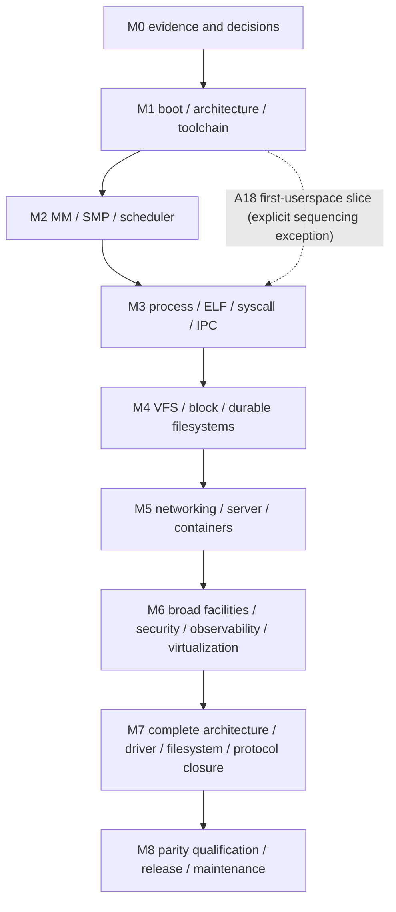

# Roadmap: complete porting program, M0–M8

## Status and interpretation

**This page is the complete program and inventory, not the day-to-day work queue.** The ordered queue of concrete repairs and capabilities, with status at the current `main`, dependencies and one acceptance test each, is [next steps](next-steps.md); the authoritative current state is in [implementation](implementation.md#current-status). Work packages below carry no status; §1 is a snapshot that is refreshed on a best-effort basis and loses to those two pages.

This is the single, complete, dependency-ordered program ([A19](decisions.md)) for porting Linux **6.18.57** to an idiomatic Rust modular-monolithic kernel. It sits on a real bounded x86_64 bootstrap, an immutable integration/package checkpoint and later foundation work in [implementation](implementation.md). **M1 is in progress, not complete**; M2–M8 remain milestone obligations. The unchanged five-column [workstream ledger](../planning/workstreams.tsv) marks only the canonical [routed implementation owners](implementation.md#routed-implementation-status) `in_progress`; all other rows remain `not_started`. This means real work has begun, not that any prefix is fully translated or Linux-compatible. M0 remains conditional on independent provenance/design review, reference configurations and access/recovery obligations. Local source-signature evidence exists; no dates, staffing sufficiency, M1 completion, Linux parity, physical pass or performance pass are claimed. Work packages (WPs) below are planning units: they carry **no status column, percentage or completion claim**, and the ledger schema is unchanged.

The standing project rule is to continue implementation until every required facility is ported and evidence-qualified; it does **not** authorize representing the historical planning delivery or the current bootstrap as the finished kernel. [Definition of done](definition-of-done.md) supplies exhaustive per-unit/subsystem/full-kernel closure; this roadmap specifies architecture, dependency gates, WPs and milestone exit evidence. Accepted user constraints, recorded engineering choices and unresolved obligations are distinct in [decisions](decisions.md). Initial M1 sequencing and integration Clippy are engineering/verification choices, not newly invented detailed user approvals. Scope is never reduced to make a gate pass: every architecture, driver family, filesystem, protocol, security facility and obscure interface of the pinned tree stays in scope (see the [coverage map](#7-coverage-map)); x86_64 QEMU and server/container workloads are sequencing priorities only.

Accepted architecture/policy choices are a **modular monolithic Rust kernel**, unavoidable function-local **`asm!` and `naked_asm!` with proofs** (no `global_asm!` or standalone assembly), and a **fixed 6.18.57 feature/behavior inventory with explicitly reviewed security deltas**. Later feature-baseline changes require a separate decision. Per-operation assembly proofs, detailed security-delta approval workflow, maintenance cadence/resources, staffing and statistical levels remain review/decision work, not silently accepted defaults. Every baseline module's functionality needs a Rust replacement without legacy C execution; arbitrary third-party/proprietary out-of-tree functionality needs separate enumeration and approval.

Every milestone uses the same evidence tuple: pinned implementation/reference source; feature/configuration and ABI scope; compiler/linker/rootfs/firmware identities; case definitions/seeds; raw logs and individual outcomes; security/unsafe review; physical platform identity without unnecessary personal serial data; performance samples/noise/confidence; failure/recovery results; owner and unresolved blockers. A skip, unavailable device, benchmark ambiguity, placeholder, crash without diagnosis or silent test exclusion is not a pass. Exit applies to the explicitly enumerated milestone slice, never to the whole baseline unless M8 says so. **QEMU never replaces physical evidence; performance at least the pinned real Linux baseline is a release gate, not a property of Rust or of this plan.**

Reading guide: [§1](#1-status-snapshot) snapshot · [§2](#2-dependency-map-and-concurrency) spine and lanes · [§3](#3-idiomatic-rust-kernel-architecture) architecture and abstractions · [§4](#4-crate-strategy) crate policy · [§5](#5-port-unit-workflow) per-WP workflow · [§6](#6-milestones-and-work-packages) M0–M8 WPs · [§7](#7-coverage-map) coverage map · [§8](#8-risks-and-blockers) risks · [§9](#9-primary-rationale-and-reference-links) references.

## 1. Status snapshot

| Area | Exists (observed; evidence in [implementation](implementation.md)) | In flight | Open |
| --- | --- | --- | --- |
| Boot / x86_64 | Limine base-5 UEFI64 ELF on q35/OVMF; checked handoff; `kernel/src/{boot,cpu,firmware,sync}.rs`: descriptors with Linux GDT selectors on the vendored `x86_64`/`raw-cpuid` crates, exception/IRQ entries incl. the repaired error-code boundary, Linux `pt_regs` `SYSCALL` entry and `iretq` ring-3 entry, SMEP/SMAP/UMIP, user FPU and XSAVE state (XSAVES/XSAVEC/XSAVEOPT/XSAVE, AVX-512, `PKRU`, [record](implementation.md#extended-cpu-state-xsave-pkru); FXSR-only under `noxsave` or without XSAVE), PIC/PIT, saved-IF raw spinlock, ACPI static-table discovery | — | AMX/`XFD` and supervisor xstate, `pkey_*` and the execute-only key, CPU-vulnerability mitigations, SMP (private SMP findings SMP00201/00202 open), non-x86. (APIC/x2APIC/IOAPIC, HPET, TSC calibration, TSS/IST and timekeeping landed in PR #17.) |
| Memory | Indexed buddy (orders 0–10), non-copy `Frame` ownership, owned 4-level CR3 with W^X/guards, scalar Rust `memset`/`memcpy` providers (`kernel/src/{memory,buddy,paging,bitmap,runtime}.rs`) | — (the A18 slice's user mappings and `usercopy` landed; the [memory-mapping wiring](implementation.md#memory-mapping-wiring) adds the VMA set, `brk`/`mmap`/`munmap`/`mprotect`/`madvise`, demand-zero paging and zero-page COW for anonymous memory; since then private file mappings (PR #22), `mremap` (PR #34) and RSS accounting (PR #32); no `fork` COW, shared writable file mappings or reclaim) | Zones/watermarks, slab/vmalloc, reclaim/OOM, NUMA, THP, memcg, page cache |
| Image / exec | Checked newc/crc CPIO and structural ELF inspection of Limine boot modules (`kernel/src/image/`); **A18 first-userspace slice** ([A18](decisions.md)): a static `/init` found in the initramfs and run in ring 3 with Linux's `load_elf_binary` plan order, exact `create_elf_tables` stack/auxv, `write`/`getpid`/`exit`/`exit_group` and configuration-equivalent `-ENOSYS`, Linux-exact init-death/segfault/no-root texts; BSP-only, storage-free, valid only under the declared configuration (`vdso=0`, `CONFIG_RSEQ=n`, `ia32_emulation=0`, `norandmaps`). Since then (PRs #22–#35) a FIFO scheduler, `fork`/`clone`/threads/`execve`/`wait`, signals, tmpfs/procfs VFS, dynamic ELF, futexes, a console tty and BusyBox and glibc programs run on that one CPU | — | SMP, durable storage, networking, everything else in M2–M8 ([next steps](next-steps.md)) |
| Host tooling | `xtask` (structural audit with vendor verification of 23 packages, `kernel-build/test/package`, `baremetal-suite`, `tty-oracle`), `baremetal` bounded smoke runner; the QEMU suite with Rust-generated initramfs fixtures and a harness-built `/init`: 54 debug-exit and 5 suite cases matched in the last recorded gate (`threads-int-1`, [record](implementation.md#threads-integration-onto-the-dynamic-elf-lane)); the 18/18 fresh-offline-clone comparison at `main` 6aaeb93 is the only fresh-clone record ([v0.1.0](implementation.md#v010-continuation-checkpoint)); earlier catalogs are history | [Next steps](next-steps.md) items 1 and 6 (compiler discovery, committed gate command, configurable firmware paths, CI) | Rust registries/generators (§6 WP-M0.3), perf harness, package for replacement kernel |
| Physical | Only corrected `diagnostic-003` is conditionally cleared for the user's separate-media/recovery trial ([handoff](diagnostic-handoff.md)); 001/002 withdrawn | — | No physical evidence exists; no later lineage is cleared |
| Ledger | 36 routed rows `in_progress`, 2,587 `not_started` of 2,623; 97,294 inventory entries | — | Not a compatibility percentage |

No milestone exit is claimed by this snapshot: M1 remains in progress and the declared-configuration limits above bound what the A18 slice shows.

Scale reference, not a progress measure: at `main` 9804570 `kernel/src` is 145 `.rs` files and 92,205 lines (counted by the 2026-10-21 documentation audit; it was 17 files / 7,073 lines at the A18 slice); the pinned tree has 91,246 files.

## 2. Dependency map and concurrency



This is an integration dependency spine, not a ban on early parallel work. Storage format/parser research, driver inventory, network state-machine tests, architecture backend investigation, security hooks and packaging design begin before their integration milestones, once their shared contracts exist. Physical-hardware preparation starts at M0 and candidate physical execution starts at M1. Security, performance, observability, licensing and tests are continuous; M6 is broad facility closure, not the first security work. M7 is breadth closure, not the first non-x86 design research. Server priority never deletes desktop, audio/graphics, embedded/RT, legacy or obscure support. The A18 slice is single-task and BSP-only: it does not satisfy any M2/M3 exit and its user address space, usercopy, ELF mapping and syscall entry are the **first versions of the shared M2/M3 mechanisms**, not a parallel implementation (no second usercopy layer, ABI codec or address-space type).

The [subsystem index](README.md) and [workstream inventory](../planning/workstreams.tsv) determine owners. Shared allocator/locking/RCU/usercopy/DMA/device contracts are prerequisites for leaf implementation, and cross-subsystem API changes migrate all callers in one cutover.

**Continuous lanes** (run beside every milestone; each WP's evidence must name the lane outputs it consumed):

| Lane | Output | First needed |
| --- | --- | --- |
| C1 provenance/licensing | Per-file SPDX/source-commit/transformation record for every ported unit ([licensing](licensing.md)) | first port WP |
| C2 unsafe/asm register | Per-site necessity + SAFETY proofs, disassembly evidence ([toolchain](toolchain.md)) | M1 |
| C3 verification harness | Rust-owned differential runner vs pinned Linux (syscall traces, ioctl/netlink/proc/sysfs snapshots), model tests, fuzz targets ([verification](verification.md)) | M1 (A18) |
| C4 performance | Pre-registered paired/interleaved harness, per-cell baselines on matched Linux builds ([performance](performance.md)) | M2 |
| C5 physical lab | User-operated candidate runs, recovery rehearsal, returned artifacts ([bare metal](bare-metal.md)) | M1 |
| C6 security review | Threat model per WP, independent review record, fuzz/exploit regressions ([security](subsystems/security.md)) | M1 |
| C7 ledger/docs | Routing, plan, skill, changelog agreement; `xtask check`/`status` | every PR |
| C8 toolchain | Exact-compiler pins, backend gap register per architecture, reproducible builds | M0 |

**Critical path** (longest dependency chain; everything else hangs off it): WP-M1.5 core types → WP-M2.3 locks/RCU/atomics → WP-M2.1/2.2 allocators → WP-M2.4 SMP → WP-M2.5 scheduler → WP-M3.2/3.3 syscalls and tasks → WP-M3.9 VFS spine → WP-M4.1 VFS completion → WP-M4.4/4.5 block + first storage driver (+ WP-M4.13 AML for physical firmware) → WP-M4.7 first durable filesystem → WP-M5.4/5.5 IP + TCP → WP-M5.8/5.9 namespaces + cgroups → M6 security/BPF/KVM → M7 breadth → M8 qualification. Physical-hardware access and compiler backends (WP-M1.7) are the two external-dependency chains that can stall it.

## 3. Idiomatic Rust kernel architecture

Everything here is a **proposed design** under accepted decision A15, constrained by [architecture](architecture.md) and the AGENTS contract. It is revised by the owning plan when a WP proves a better shape; a divergence is recorded in that plan, not silently coded.

### 3.1 Workspace layout and dependency direction

Today the kernel is one crate (`kernel`: library for host-testable parsers/primitives plus a gated freestanding binary). Crates are split only at an independently useful dependency, unsafe or configuration boundary (never one per upstream file). Arrows read "may depend on"; a crate may depend only on rows above it. Upward calls (a lower layer invoking a higher-layer implementation) use registered `&'static dyn` operation tables or generic parameters, exactly where Linux uses `*_operations` structs; there are no cycles and no `pub` back-edges.

| Layer | Target crate(s) (names provisional) | Responsibility | Upstream area | May depend on |
| --- | --- | --- | --- | --- |
| L0 ABI | `lrs-abi` | `repr(C)` UAPI structs/constants, errno/syscall/ioctl numbers, per-arch layouts; `no_std`, no alloc, host-testable; **generated** where upstream tables exist | `include/uapi`, `arch/*/include/uapi` | `core` |
| L1 base | `lrs-base` | `Errno`/`KResult`, `Gfp`, address newtypes, checked arithmetic, endian/byte cursors, bitmap, intrusive list, `KArc`/refcount, `pin-init`-style initialisation, `Pod` decoding | `lib/`, `include/linux` basics, `rust/kernel` ideas | `lrs-abi` |
| L2 arch | `lrs-arch-x86_64`, later one per architecture (`lrs-arch-<name>`) behind trait `Arch` | entry/return, CPU state, barriers, MMU/TLB, IRQ controller glue, clocks, usercopy primitives, atomics/ordering shims, firmware handoff | `arch/<name>` | `lrs-base` |
| L3 mechanisms | `lrs-sync` (locks, lockdep, RCU, per-CPU, wait/completion, seqlock), `lrs-mm` (page/slab/vmalloc/VMA/fault/reclaim/page-cache core), `lrs-time`, `lrs-irq`, `lrs-sched`, `lrs-work` | cross-subsystem invariants | `kernel/{locking,rcu,sched,time,irq,workqueue.c}`, `mm`, `lib` | L2 and earlier L3 rows (`sync` → `mm` → `time/irq` → `sched` → `work`). `lrs-sync` must block and wake tasks but sits below `lrs-sched`, so it defines the `SchedHooks` trait (`block_current`, `wake`, `set_current_state`, `need_resched`, preempt count) that `lrs-sched` implements and `lrs-kernel` registers once at init - the Linux sync/sched cycle is broken by this one trait, not by a back-edge |
| L4 services | `lrs-task` (fork/exec/signal/cred/ns/cgroup), `lrs-uaccess` (UserSlice on the arch extable core), `lrs-vfs`, `lrs-block`, `lrs-net-core`, `lrs-ipc`, `lrs-devmodel` (bus/driver/device/devres/DMA/irq registration), `lrs-security` (caps + LSM framework), `lrs-crypto-api`, `lrs-trace` | public services | `kernel/*`, `fs/*.c`, `block`, `net/core`, `ipc`, `drivers/base`, `security/*.c`, `crypto` | L0–L3, and lower L4 rows via traits |
| L5 families | `lrs-fs-<fs>` (large, independently configured), `lrs-net-<family>`, `lrs-drv-<bus-or-class>` (**one crate per class; individual drivers are feature-gated modules**, per architecture.md "split only at independently useful boundaries"), `lrs-lsm-<name>`, `lrs-crypto-<provider>`, `lrs-bpf`, `lrs-kvm-<arch>`, `lrs-module` | leaf implementations, feature-gated | `fs/<fs>`, `net/<proto>`, `drivers/*`, `security/<lsm>`, `kernel/bpf`, `virt`, `kernel/module` | L4 service traits only; never each other except through a service trait |
| L6 ABI façade | `lrs-sys` (syscall table + entry glue), `lrs-procfs-sysfs`, `lrs-netlink-uapi`, ioctl tables | translate Linux ABI to internal types without redefining layouts | `arch/*/entry/syscalls`, `fs/proc`, `net/netlink` | L4–L5 |
| L7 image | `lrs-kernel` | init sequencing, configuration (Cargo features ↔ Kconfig), linker script, panic/crash glue, the only binary | `init/`, `Kconfig`, `Makefile`s | everything |
| Host | `xtask`, `baremetal`, future `lrs-diff`, `lrs-perf`, `lrs-pkg` | audit, build/test/package, differential and performance harnesses, registries/generators | `scripts/`, `tools/` (as references) | `std`; never linked into the kernel |

Configuration: Kconfig symbols map to Cargo features plus a Rust-owned resolver (WP-M0.3) that reads the pinned `Kconfig` files, rejects invalid combinations exactly as upstream does and emits the per-cell build manifest (Q06). Cargo features are additive, so `choice`/`depends on` conflicts are enforced by the resolver, not by feature unification. Tables that upstream generates (syscalls, errno, `lsm_hook_defs.h`, ioctl numbers, PCI/ACPI ID tables where mechanical) are produced by Rust `xtask` generators into **checked-in** modules; `xtask check` fails if a generated file is stale. `build.rs` is prohibited in project-owned code (the audit rejects any `build.rs` file); vendored third-party build scripts are a separate, reviewed exemption (§4, step 5). Names like `lrs-drv-<class>-<device>` in the WP tables denote feature-gated modules inside the class crate.

### 3.2 Foundational abstractions: concrete shapes

```rust
// ---- lrs-base: errors, allocation context, addresses ---------------------------------
#[repr(transparent)] #[derive(Clone, Copy, PartialEq, Eq)]
pub struct Errno(NonZeroU16);                 // UAPI errnos only: 1..=133 on x86_64 (generated from the errno headers)
pub enum KernelErr { Errno(Errno), Internal(Internal) }   // Internal = ERESTARTSYS/NOINTR/NOHAND/RESTART_RESTARTBLOCK (512..516),
                                              // ENOIOCTLCMD (515), EPROBE_DEFER (517), ... up to 541: never user-visible
pub type KResult<T = ()> = Result<T, KernelErr>;
impl KernelErr { pub fn to_user(self, site: AbiSite) -> Errno; }   // the single translation point: ENOIOCTLCMD -> ENOTTY at ioctl exit,
                                              // restart codes resolved by the signal/exit path, EPROBE_DEFER handled by the driver core
// Gfp is a class-typed bit-exact gfp_t: the class decides at COMPILE time whether sleeping is allowed.
pub struct Gfp<C: GfpClass>(u32, PhantomData<C>);       // GfpClass = Sleepable (reclaim allowed) | Atomic (no sleep)
impl Gfp<Sleepable> { pub const KERNEL: Self; pub const NOFS: Self; pub const NOIO: Self; pub const USER: Self; /* ... */ }
impl Gfp<Atomic>    { pub const ATOMIC: Self; pub const NOWAIT: Self; /* ... */ }   // usable in IRQ/atomic context; ATOMIC may use reserves (__GFP_HIGH), NOWAIT never does
pub struct AllocError;                        // becomes ENOMEM only at the ABI edge
impl<T> KBox<T> {
    pub fn try_new(v: T, gfp: Gfp<Atomic>) -> Result<Self, AllocError>;                                 // any context
    pub fn try_new_sleepable(v: T, gfp: Gfp<Sleepable>, _s: &MaySleep) -> Result<Self, AllocError>;     // task context only
}
impl<T> KVec<T> { pub fn try_push(&mut self, v: T, gfp: Gfp<Atomic>) -> Result<(), AllocError>; pub fn try_push_sleepable(..); pub fn try_reserve(..); }
// (the real API is one generic `Alloc<C>` trait; the proof rule is the point: only `Gfp<Sleepable>` operations take `&MaySleep`)
// No Box::new / vec! / infallible push in kernel crates (lint-enforced). NOFS/NOIO scopes are guards (memalloc_nofs_save).
// `MaySleep` is a zero-sized proof obtainable only in sleepable task context (spin/RCU/IRQ guards never yield one), so IRQ code
// can still allocate with GFP_ATOMIC but can never name a sleeping class. The dynamic layer (might_sleep, preempt_count, lockdep)
// still backs this up where the type system cannot see (e.g. an arbitrary callback invoked under a spinlock).

pub struct PhysAddr(u64);  pub struct VirtAddr(u64);  /* canonical-checked */  pub struct Pfn(u64);
pub struct UserVa(usize);  /* never convertible to VirtAddr */  pub struct DmaAddr(u64); /* only via a DMA mapping */
pub struct Frame { phys: PhysAddr, order: u8 } // !Copy !Clone, Drop returns to the buddy (exists today: kernel/src/memory.rs)

// ---- lrs-uaccess: never dereference a user address ----------------------------------------
pub struct UserSlice { ptr: UserVa, len: usize }       // access_ok-checked at construction
impl UserSlice { pub fn reader(self) -> UserReader; pub fn writer(self) -> UserWriter; }
impl UserReader { pub fn read<T: Pod>(&mut self) -> Result<T, Fault>;
                  pub fn read_raw(&mut self, dst: &mut [MaybeUninit<u8>]) -> Result<(), Fault>; }
pub struct Fault { pub copied: usize }                 // short-copy count preserved: Linux returns "bytes not copied"
// `Pod` is lrs-base's own trait (any bit pattern valid, no padding); if zerocopy is later adopted it backs this trait, never a second one.
// Fault recovery = exception-table entry emitted by a single function-local asm! (.pushsection __ex_table) per primitive.
// The extable core is NOT usercopy-specific: it lives in lrs-arch-x86_64 (WP-M1.2, like arch/x86/mm/extable.c) and `fixup_exception`
// runs from #PF, #GP, #UD, #DE, #MC and others (MSR access with fault fixup, FPU/xstate restore, usercopy all use it).
// lrs-uaccess only adds the STAC/CLAC (SMAP) bracket and Fault mapping on top; fault -> Fault, never a panic.
```

```rust
// ---- lrs-sync: lock classes, guards, RCU, per-CPU ---------------------------------------------
pub trait LockClass: 'static { const NAME: &'static str; }
pub struct RawSpinLock<T, C: LockClass>;   // never sleeps, even on PREEMPT_RT
pub struct SpinLock<T, C: LockClass>;      // ordinary: sleeping on RT
pub struct Mutex<T, C: LockClass>;  pub struct RwSem<T, C: LockClass>;  pub struct SeqLock<T, C: LockClass>;
impl<T, C: LockClass> SpinLock<T, C> {
    pub fn lock<'a, H: LockBefore<C>>(&'a self, held: &'a mut LockCtx<H>) -> (Guard<'a, T, C>, LockCtx<C>);
    pub fn lock_irqsave(..) -> IrqGuard<'a, T, C>;           // restores the saved IF state in Drop; !Send
}
// Order = marker trait `LockBefore<C>` (compile-time, for hot subsystem-internal hierarchies) + a registered class graph
// checked at runtime by the lockdep-equivalent in debug builds. Every `declare_lock_order!(A < B)` feeds an xtask check
// that merges all subsystem plans' DAGs and rejects cycles (AGENTS: cross-subsystem edge recorded in both owners' DAGs).

pub struct RcuReadGuard<'a>(PhantomData<(&'a (), *const ())>);   // genuinely !Send/!Sync via the raw-pointer marker
// Flavours as in the pinned tree (classic/BH/sched were consolidated in v4.20): ONE consolidated RCU whose read side is
// rcu_read_lock() (rcu_read_lock_bh/_sched keep their disable-BH/preempt side effects), SRCU (per-`Srcu` domain, the read
// lock returns an index token that must be handed back), and Tasks RCU / Tasks-Rude / Tasks-Trace as separate types.
pub struct Rcu<T> { ptr: AtomicPtr<T> }
impl<T> Rcu<T> {
    pub fn read<'g>(&self, _g: &'g RcuReadGuard<'_>) -> Option<&'g T>;      // Acquire/consume ordering argued in the module
    pub fn replace(&self, new: Option<RcuBox<T>>, _w: &WriterProof<'_>) -> Option<Retired<T>>;
}
impl<T> Retired<T> { pub fn call_rcu(self); pub fn synchronize(self, _s: &MaySleep); }   // typed deferred free via embedded RcuHead
// call_rcu callbacks run in softirq / RCU kthread context: `T::drop` must not sleep; teardown that sleeps is queued to a workqueue.
pub struct PerCpu<T>;
impl<T> PerCpu<T> { pub fn get<'g>(&self, g: &'g PreemptGuard) -> &'g T;   // T: interior-mutable (Cell/Atomic); guard pins CPU
                    pub fn on(&self, cpu: CpuId) -> &T where T: Sync; }
```

```rust
// ---- lrs-sys: syscall table generated from pinned syscall_64.tbl (+ syscall_32.tbl for IA32 emulation) ----------------
// `cargo xtask gen-syscalls` -> checked-in syscalls_x86_64.rs: 419 non-comment rows (336 common, 47 64, 36 x32) + 459 ia32 rows.
syscall_table! { 0 common read => sys_read, 1 common write => sys_write, /* ... */ 512 x32 rt_sigaction => compat_sys_rt_sigaction }
fn sys_read(fd: Fd, buf: UserSlice, count: usize) -> SysResult<usize>;       // typed arguments decoded by `FromSyscallArg`
// `FromSyscallArg` is the ONLY argument codec: sign/zero extension for compat, split 64-bit halves, __kernel_off_t/time64.
// `SysResult -> -errno` and restart translation happen in exactly one exit function. Reserved holes return what upstream
// returns for that number (sys_ni_syscall semantics), with differential evidence per number, never a blanket ENOSYS.

// ---- lrs-vfs: operation tables as traits with Linux-default method bodies -------------------------------------------
pub trait InodeOps: Send + Sync { fn lookup(&self, dir: &Inode, name: &DName, s: &MaySleep) -> KResult<Option<DentryRef>>; /* create, link, unlink,
    rename(RenameFlags), getattr, setattr, permission, get_acl, listxattr ... */ }
pub trait FileOps: Send + Sync { fn read_iter(&self, k: &mut Kiocb, to: &mut IovIter<Dest>) -> KResult<usize>;
    fn write_iter(..); fn iterate_shared(..); fn mmap(..); fn unlocked_ioctl(..); fn compat_ioctl(..); fn poll(..); fn fsync(..); fn release(..); }
// Every default method returns the errno upstream returns for a NULL op in that call site (EINVAL/ENOTTY/EISDIR/...),
// derived from fs/*.c per op - so "operation not provided" is never an invented behaviour.
pub trait AddressSpaceOps { fn read_folio(..); fn writepages(..); fn dirty_folio(..); fn readahead(..); /* migrate_folio, direct_IO ... */ }
pub trait FsType { const NAME: &'static str; fn init_fs_context(fc: &mut FsContext) -> KResult; fn kill_sb(sb: SuperBlock); }
```

```rust
// ---- lrs-devmodel: bus/driver/device, managed resources, DMA, IRQ ------------------------------------------------------
pub trait Bus { const NAME: &'static str; type Id: IdTableEntry; fn matches(dev: &Device<Normal>, id: &Self::Id) -> bool; }
pub trait Driver<B: Bus>: Sized + Send + Sync {
    const ID_TABLE: IdTable<B::Id>;
    fn probe(dev: &Device<Core>, id: &B::Id) -> KResult<Pin<KBox<Self>>>;  // Device<Core> -> Device<Bound> typestate proves bound-ness
    fn remove(self: Pin<&Self>, dev: &Device<Bound>);                     // quiesce hardware, drain IRQ/work/DMA, then drop
}
pub struct Devres<T>;                 // revocable: MMIO/IRQ/DMA resources die with driver unbind; access after unbind -> Err, not UAF
pub struct CoherentAlloc<T: ?Sized> { cpu: NonNull<T>, dma: DmaAddr, dev: ARef<Device> }   // Drop unmaps/frees in the right order
// It NEVER hands out &T/&mut T for device-written memory (aliasing/volatility rule): only volatile/atomic accessors
// (`read_volatile(i)`, `write_volatile(i, v)`, `dma_addr()`); a typed view is an `unsafe fn` with stated caller obligations.
pub struct StreamMapping<'a, D: Direction>;     // into_device()/into_cpu() = dma_sync_* ownership transfers; unmap on Drop
pub trait IrqHandler: Sync { fn handle(&self, c: &HardIrq) -> IrqReturn; }          // no MaySleep available; only Gfp<Atomic> allocations
pub trait ThreadedIrq: IrqHandler { fn thread_fn(&self, s: &MaySleep) -> IrqReturn; }
// free_irq() sleeps and waits for in-flight handlers, so release is explicit: `IrqRegistration::release(self, &MaySleep)` = free_irq().
// A plain Drop (possibly in atomic context) does disable_irq_nosync() and moves registration + handler data to a worker that calls
// free_irq() and only THEN drops the data: the handler can still run after the owner's Drop returns, so it must never see freed state.

// ---- lrs-net-core: packet ownership ---------------------------------------------------------------------------------------
pub struct SkBuff { head: PacketBuf, data_off: u32, len: u32, shinfo: SharedInfo /* frags, frag_list, gso */, meta: SkbMeta /* protocol, csum state,
    dev: Option<NetDevRef>, sock: Option<SockRef>, cb: [u8; 48] */ }
impl SkBuff { pub fn put(&mut self, n: usize) -> KResult<&mut [u8]>; pub fn push(..); pub fn pull(..); pub fn make_writable(&mut self, gfp: Gfp<Atomic>) -> KResult<&mut Self>; }
// Three distinct sharing levels, as in Linux: (1) the unique owner moves through queues (Box-like, `&mut` access);
// (2) `skb_get` = `SkbRef` bumps `skb->users`: the SAME sk_buff is shared read-only (metadata AND data), mutation impossible until unique;
// (3) `skb_clone` = new sk_buff with private metadata sharing the data area via `dataref` (`SkbShared`); `make_writable` is
// copy-on-write (pskb_expand_head) whenever users>1 or dataref>1 or the buffer is cloned. Counters use `Refcount` (saturating).
// Upstream skb_over_panic/BUG sites (kernel logic errors) become checked Errs or debug assertions: no input may panic the kernel.
```

The remaining abstractions follow the same pattern; each row names the upstream mechanism it ports and the **Linux-visible semantics the Rust type must not change**:

| Abstraction | Rust shape (summary) | Upstream mechanism | Semantics that must be preserved |
| --- | --- | --- | --- |
| Refcounts | `Refcount` saturating atomic; `KArc<T>` with fallible `try_new`, `ArcBorrow`, `UniqueArc` | `refcount_t`, `kref`, `rust/kernel/sync/arc.rs` | saturate-and-warn on overflow, no resurrection of a zero count, `dec_and_test` ordering (release + acquire on zero) |
| Pinned init | `pin-init` in-place constructors, `Pin<KBox<T>>`, `#[pin_data]` | `rust/pin-init` | fallible in-place init; drop order on partial-init failure |
| Intrusive list / tree | `List<T, ID>` with `ListArc` unique-ownership token; rbtree/maple/xarray as Rust ports | `include/linux/list.h`, `rust/kernel/list`, `lib/{rbtree,maple_tree,xarray,radix-tree}.c` | iteration under RCU, unlink-before-free, stable ordering/iteration results where observable (e.g. `getdents`) |
| Wait / completion | `WaitQueue`, `wait_event!` taking a condition closure and a `Sleep` mode (interruptible/killable/uninterruptible/timeout) | `kernel/sched/wait*.c`, `completion.c` | no lost wakeup, signal-interrupted waits return the same errno, exclusive-wake ordering |
| Atomics | `core::sync::atomic` with a documented happens-before per use; `smp_*`/`READ_ONCE`-equivalents as named helpers | `tools/memory-model`, `include/asm-generic/barrier.h` | LKMM litmus tests ([litmus](https://raw.githubusercontent.com/gregkh/linux/v6.18.57/tools/memory-model/README)) re-expressed as loom-style/model tests; no mechanical Linux-to-Rust ordering translation |
| Timers / work | `HrTimer<T: TimerCallback>` and `Work<T>` embedded intrusive nodes (pinned); `Workqueue` with `UNBOUND`/`MEM_RECLAIM` | `kernel/time/hrtimer.c`, `timer.c`, `kernel/workqueue.c` | callback context rules, `cancel_*_sync` semantics, rescuer thread for reclaim-capable queues |
| Scheduler classes | `trait SchedClass` (enqueue/dequeue/pick_next/put_prev/task_tick/wakeup_preempt/balance) with fixed static priority order stop > deadline > RT > fair > ext > idle | `kernel/sched/*` (EEVDF in 6.18) | niceness/weights, EEVDF lag/slice rules, RT throttling, `sched_setattr` ABI and errors, `/proc/sched*` outputs |
| Task / process | `Task` (RCU-visible, refcounted), `PidNs`/`Pid` hash, `Cred` immutable + RCU swap, `Signal`/`SigHand` | `kernel/{fork,exit,pid,signal,cred}.c` | clone flag matrix and errors, wait status encoding, reparenting, orphaned pgrp, restart behaviour |
| Futex | hash of `FutexQ`, PI via `RtMutex` with owner-death handling | `kernel/futex/`, `kernel/locking/rtmutex.c` | robust-list walk limits, `FUTEX_CMP_REQUEUE_PI` rules, errno precedence |
| Page cache / writeback | `Folio` ownership states (locked/dirty/writeback/uptodate) as typestate where cheap, XArray index, `WritebackControl` | `mm/{filemap,page-writeback,readahead,truncate}.c`, `fs/{buffer,fs-writeback}.c`, `fs/iomap` | dirty-throttling, `fsync`/`sync_file_range` ordering, `O_DIRECT` coherence, `mmap` + `write` coherence |
| Block | `Bio` owning `BioVec` segments; `BlkMqOps::queue_rq` receiving `Request<'_>` typestate (Idle → Started → Completed); flush/FUA/discard as `ReqOp` | `block/{bio,blk-mq,blk-flush}.c` | completion exactly once, requeue/timeouts, flush ordering, partial completion, `bio` splitting rules |
| ioctl codec | `const fn ioc(dir, ty, nr, size)` parameterised by the per-arch `_IOC` layout in `lrs-abi`; `ioctl_table!` mapping command → typed handler; 32-bit compat translators; internal `ENOIOCTLCMD` never reaches userspace | `include/uapi/asm-generic/ioctl.h` **plus the per-arch overrides** (`arch/{alpha,mips,parisc,powerpc,sparc}/include/uapi/asm/ioctl.h`), `fs/ioctl.c`, per-driver `compat_ioctl` | exact per-architecture `_IOC` encoding, `ENOIOCTLCMD`→`ENOTTY` translation, `ENOTTY` for unknown, size-field checks, compat struct conversion |
| Netlink codec | borrowed `NlAttr` iterators validated against const `NlaPolicy` tables; fallible `NlMsgBuilder`; `ExtAck` | `net/netlink`, `lib/nlattr.c`, `net/core/rtnetlink.c`, genetlink | policy validation order and errno, dump continuation, multicast groups, extack strings |
| proc / sysfs / debugfs | `SeqFile` + `Attr` traits generating text byte-exactly; sysfs attribute groups on `kobject`-equivalent | `fs/{proc,sysfs,kernfs,seq_file.c}` | exact text formats, permissions, `poll`/`notify` behaviour, one-value-per-file rules |
| Credentials / LSM | `Cred`, `CapSet`, `Lsm` hook table generated from `lsm_hook_defs.h`, per-object security blobs sized at registration | `kernel/cred.c`, `security/security.c`, `commoncap.c` | hook call order and short-circuit rules, default-allow vs deny per hook, capability bounding/ambient rules, mediation of every object access |
| Crypto | `trait Hash/Skcipher/Aead/Akcipher/Rng` + algorithm registry with priorities and template composition by name (`"gcm(aes)"`) | `crypto/`, `lib/crypto` | algorithm names/priorities visible via `/proc/crypto` and `AF_ALG`, self-test-on-register, constant-time and zeroize rules |
| BPF | typed `Insn` decode; verifier state (`RegState` with tnum + signed/unsigned ranges, pointer kinds) and state pruning; interpreter first, then per-arch JIT into RW→RX `ExecAlloc` | `kernel/bpf/{verifier,core,syscall,btf}.c`, `arch/x86/net/bpf_jit_comp.c` | accept/reject parity with the pinned verifier (differentially), log format, complexity limits, JIT-vs-interpreter equivalence, constant blinding |
| Modules | Rust-only module format: exact-build identity, relocation, signing, symbol export with version check, quiescent unload | `kernel/module/`, `kernel/livepatch/` | `init_module`/`finit_module`/`delete_module` errors, taint flags, `/proc/modules`, unload refusal while in use (Q15) |
| Virtualization | `Vm`/`Vcpu` handles behind `/dev/kvm` file ops; per-arch backend trait; stage-2/EPT MMU with shared notifier to `lrs-mm` | `virt/kvm`, `arch/x86/kvm` | `KVM_*` ioctl layout and errors, exit-reason ABI, dirty logging, migration state |

### 3.3 Idiom rules every WP obeys

| Rule | Consequence |
| --- | --- |
| Make illegal states unrepresentable where it costs nothing at run time | Typestate for locks held, device bound-ness, request/bio lifecycle, DMA ownership direction, `MaySleep`; zero-sized tokens, no dynamic cost |
| Errors are values, never panics | Any input a user, disk, network or device can influence returns `KResult`; `unwrap`/indexing/slicing/arithmetic overflow on such data is a defect (overflow-checks stay on in release for the kernel) |
| One representation per concept | One `Errno`, one address newtype family, one usercopy layer, one ABI argument codec, one allocator front end, one lock/IRQ-state model, one DMA mapping layer |
| `Drop` is context-checked | Types whose release may sleep take a `MaySleep` in an explicit `release()` and have a `Drop` that defers to a worker; Drop in IRQ/NMI never sleeps (architecture §"Ownership") |
| Unsafe is a leaf property | Only `lrs-arch-*`, `lrs-sync`, `lrs-mm`, `lrs-uaccess`, DMA/MMIO and intrusive-list internals contain `unsafe`; every `unsafe` has a local SAFETY proof and every `unsafe fn`/`unsafe trait` states caller obligations; `unsafe_op_in_unsafe_fn` stays denied; unsafe `Send`/`Sync` impls carry their own argument |
| Generics where the set is closed, `dyn` where Linux registers | Scheduler classes, lock flavours, arch ops: generics/enums (inlinable). Filesystems, protocols, drivers, LSMs, crypto algorithms: `&'static dyn` tables mirroring Linux's open registration |
| Host-testable by default | Parsers, codecs, state machines, allocators' pure logic and ABI encoders build and run under host `std` with the same source; context-dependent behaviour is tested in QEMU/physical |
| Tables are generated, checked in, and staleness-checked | Syscalls, errno, ioctl constants, LSM hooks, ID tables where mechanical; generator is Rust (`xtask`), output reviewed, `xtask check` rejects drift |
| No Linux C idiom is copied for its own sake | `goto err` cleanup becomes RAII; `void *private` becomes a typed associated `Data`; `container_of` becomes an intrusive-link type; macros become `const fn`/traits - **without** changing observable ordering of side effects |

## 4. Crate strategy

Standing user direction ([A20](decisions.md)): **prefer audited existing crates over reimplementation**, subject to the contract: pure Rust with no C/`-sys`/native/bindgen code, GPL-2.0-only-compatible licence, `no_std`/fallible-allocation/no-panic suitability for kernel use, reviewed unsafe. A crate that fails the contract is *rejected for that use* and the mechanism is ported directly; it is never admitted with a waiver. The admission record is [dependencies](dependencies.md).

| Step | Rule |
| --- | --- |
| 1. Search first | Every WP begins with the "Can I use a preexisting crate?" answer (CONTRIBUTING question 1): crates.io, the pinned tree's own pure-Rust code (`rust/pin-init`, `rust/kernel/{list,sync/arc}`; zero `bindings::` references in the pinned files is a hint to audit, not an audit), and direct port of the Linux algorithm |
| 2. Admit per exact configuration | Version + feature set + target; full transitive/build/proc-macro graph; build scripts; unsafe/asm; allocation and panic behaviour; endian/width; licence option selected; advisories; maintenance. Result: `admitted exact configuration`, `rejected`, or `host-only` |
| 3. One adapter per mechanism | An admitted crate sits behind one in-tree trait/wrapper so a defect or replacement is a one-place change; no second implementation of the same mechanism |
| 4. Linux semantics outrank the crate | A crate supplies a mechanism (a register type, a codec, a flag set); VFS/net/MM/sched semantics and error behaviour are always ours. Infallible-allocating crates are wrapped by reservation-before-mutation or rejected |
| 5. Vendor + pin | `Cargo.lock` + committed `vendor/` with checksum verification, notices and licence records. **The first registry dependency forces this**: today the workspace has only path members and builds `--locked --offline` with a private Cargo home, so it needs (a) committed vendored sources, (b) source replacement that does not clash with the rust-src `vendor/` used by the isolated `build-std` harness (a merged rust-src + project source directory), and (c) `kernel-build`/`kernel-package` input inventories and the structural auditor taught about `vendor/`. **Build scripts:** `build.rs` stays prohibited in project-owned code; the auditor today rejects *any* `build.rs`, so vendoring a crate that has one (see §4.1: `syscalls`, and `x86_64` via `rustversion`/`const_fn`) requires an explicit auditor allow-list limited to named `vendor/<crate>/build.rs` paths, each reviewed (network/file/process access, `cc`/linker directives, generated output) and recorded in [dependencies](dependencies.md); without that exemption those crates are not admissible |
| 6. Host tools | Same no-C/no-`-sys` rule; `baremetal` is dependency-free today and `xtask` depends only on the vendored `serde_json`, `cpio` and `elf` graph and forbids `unsafe_code`; each host crate goes through the same record, `std` allowed |

### 4.1 Research decisions (integrator rulings on the three crate-research reports)

**Status of every row: research recommendation; the admission record (version, feature union, full graph, build scripts, unsafe/asm, licence election, advisories) lands in [dependencies](dependencies.md) with each dependency PR.** Rationale and caveats are summarised inline. None is admitted by this document. "Ruling" is the integrator's decision on the recommendation.

| Functionality | Ruling | Crate@version / features | Reason |
| --- | --- | --- | --- |
| x86_64 descriptors (GDT/TSS/IDT entries, `lgdt/lidt/ltr`), CR0/2/3/4, MSRs (EFER/STAR/LSTAR/SFMASK/GS bases/APIC base), RFLAGS, selectors, page-table flag/address/index types, `invlpg`, `RdRand`, XCR0/MXCSR | **ADOPT (kernel)** | `x86_64@0.15.5`, `default-features=false, features=["instructions"]` | Deletes ~110+ lines of descriptor/register `asm!` and bit-math; `Star::write` encodes the Linux STAR layout; prototype built on the exact nightly. **Keep in-house**: our page-table walker (the crate mapper's assumptions do not fit owned-CR3/W^X/rollback), port I/O (ours deliberately omits `nomem`), the nesting IRQ guard (crate `enable()` emits `sti; nop`), every naked error-code entry stub and the ring-3 entry/SYSCALL stubs (the crate's `iretq` leaves GPRs holding kernel values). Not `0.16.0-rc.0`. **Caveats carried from the research:** the resolved graph is 7 registry crates and includes two host **proc-macro crates with build scripts** (`rustversion`, `const_fn`; each only probes `rustc --version` and prints `cargo:rustc-cfg`), plus `volatile 0.4`, `bit_field`; the crate itself needs no `alloc` or nightly feature with `default-features=false`; MIT is elected from the dual licences; these build scripts need the auditor exemption in §4 step 5 |
| CPUID feature decode | **ADOPT (kernel)** | `raw-cpuid@11.6.0`, no features | Replaces open-coded `__cpuid` bit tests; same intrinsic underneath |
| Typed flag newtypes | **ADOPT (kernel)** | `bitflags@2.13.2` | Zero deps; use `from_bits_retain` so unknown ABI bits survive |
| Linux x86_64 syscall numbers and errno tables (`Sysno`, `Errno`, incl. `ERESTART*`); raw `syscallN` layer for the `/init` test program | **ADOPT (kernel + `/init`)** | `syscalls@0.8.1`, `default-features=false, features=["x86_64"]` | Tables match the 6.18.57 pin exactly; only way to make exact raw calls without forging references (negative tests). Use `Sysno::new`/`Errno::new`, never the panicking `From<u32>`/`Index`. **Caveats:** the crate has a trivial `build.rs` (Thumb cfg detection only; needs the §4 exemption), an unconditional module of 92 lines of `asm!("syscall")` wrappers the kernel never calls (admission condition: an `xtask` check that the final ELF contains no `0f 05` outside the project's own entry code, plus asm-site review), and it covers only the 383 common+64 numbers - **no x32 or ia32** - so it is a cross-check and `/init` raw-syscall layer, while the kernel dispatch table stays generated from the pinned `.tbl` files (WP-M0.3/M3.2); it must never become a second source of truth |
| Host initramfs fixtures | **ADOPT (host `xtask`)** | `cpio@0.4.1`, `write_cpio` only | Independent writer vs our reader gives an oracle; keep hand-built bytes for malformed-archive tests |
| Host ELF checks (`check_elf`) | **ADOPT (host `xtask`)** | `elf@0.8.0`, `default-features=false` (`std` if needed) | Zero-dependency, `forbid(unsafe_code)`; replaces ELF decoders; `readelf` scraping stays as an independent oracle |
| Limine request/response layer (`boot.rs`) | **KEEP in-house** | — (`limine@0.6.5` rejected at runtime) | Nightly-only crate with layout/`unwrap` defects; used once as a request-ID cross-check |
| ACPI RSDP/XSDT/MADT framing (`firmware.rs`) | **KEEP in-house** | — (`acpi@6.1.1` rejected) | Needs `alloc`, non-terminating MADT iterator, panics |
| CPIO reader, exec-side ELF acceptance, bitmap | **KEEP in-house** | — | Crates diverge from Linux unpack/exec semantics; bitmap is a direct `lib/find_bit.c` translation |
| Typed UAPI byte layouts | **DEFER** | `zerocopy@0.8.63` (derive) | Until typed UAPI layouts need it; one of zerocopy/bytemuck, never both |
| Lock adapter, MMIO accessors, PIC, UART | **DEFER** | `lock_api@0.4.14`, `volatile@0.6.1`, `pic8259@0.11.0`, `uart_16550` | Revisit at the lock-class (WP-M2.3), APIC/HPET/virtio MMIO (WP-M1.2/M4.5) and serial-console slices |
| `/init` runtime and host syscall layer | **REJECT** | `origin`/`rustix` for `/init`; `rustix` for host tools | Lock graph pulls `windows-sys`/`libc`/`errno` (~62 MB vendored); `rustix 1.1.5` breaks `origin 0.26.2`; host tools forbid `unsafe_code` |
| AML | **REJECT existing; no admissible crate** | `acpi` `aml` feature, standalone `aml` | A Rust AML interpreter is a separate decision (fork with fallible allocation/no panics, or direct port; WP-M6.8) |
| Syscall constants at runtime, libc | **REJECT** | `linux-raw-sys@0.12.1` (generated from v6.17, missing 6.18 constants; acceptable only as a host dev-test oracle), `libc` (empty on `x86_64-unknown-none`) | Not the pinned baseline |
| ELF/object parsers, x86 helpers, locks | **REJECT** | `goblin`, `object`, `xmas-elf`, `elf_rs`, `x86`, `x2apic`, `spin`, `trapframe`, GPL-3 crates | Panics/allocation, divergence, unsound or single-core locks, licence |

### 4.2 Other candidate areas (not yet researched; all unadmitted)

| Area | Candidates to evaluate (evidence in [dependencies](dependencies.md)) | Default if rejected | Decided at |
| --- | --- | --- | --- |
| Pinned in-place init | `pin-init` (pinned `rust/pin-init`, Apache-2.0 OR MIT, pure Rust) | port `rust/kernel/init` ideas | WP-M1.5 |
| Intrusive lists, bounded queues, hash maps | `intrusive-collections`, `heapless`, `hashbrown` (collision-resistant hasher for attacker keys) | port `rust/kernel/list`, Linux `hlist`/`rhashtable`/`xarray` | WP-M2.2 |
| Atomics | `core::sync::atomic` first; `portable-atomic` only for missing widths | kernel-owned types (§3.2) | WP-M2.3 |
| Other-arch register crates | `aarch64-cpu`, `riscv`, `tock-registers`, `pci_types` | local minimal definitions with per-site asm proofs | WP-M7.2.. |
| Firmware | `uefi`, `fdt` (MPL-2.0: licence review), SMBIOS | direct port | WP-M1.3 |
| Device-register / virtio | `virtio-drivers`, `xhci` | direct driver ports; reject singleton/single-core assumptions | WP-M4.5, WP-M5.7 |
| Compression, checksums, image formats | `miniz_oxide`, `lz4_flex`, `ruzstd`, `crc`, `fatfs`, `ext4-view`, GPT parsers (codecs or *test oracles* only) | direct ports of `lib/{zlib_inflate,lz4,zstd,xz,lzo,crc}` and filesystem code | WP-M4.7, WP-M7.* |
| Cryptography | RustCrypto per-algorithm crates (no-default), `zeroize`, `subtle`; `ring`/`openssl-sys` rejected | port `crypto/`, `lib/crypto` | WP-M6.3 |
| Network codecs | `smoltcp` as oracle/codec reference only | direct port of `net/ipv4`, `net/ipv6` | WP-M5.4 |
| DWARF/symbolization | `gimli`/`addr2line` (host first) | existing tooling | WP-M6.4 |
| Hosted frameworks | Tokio, std threads, userspace KVM/BPF loaders: **not kernel dependencies** | — | rejected |

## 5. Port-unit workflow

One WP (or one sub-unit of a WP, never larger than one reviewable PR) is executed end to end as below. Steps 1–4 happen before code; a PR without them is incomplete.

| # | Step | Output (retained) |
| --- | --- | --- |
| 1 | **Pin and route.** Longest-prefix route every upstream path through [workstreams](../planning/workstreams.tsv); read the pinned source (not a distribution copy) incl. Kconfig, headers, `Documentation/` and relevant `tools/testing`; record configs and architectures | Unit manifest: paths, blob ids, Kconfig symbols, arch guards |
| 2 | **Provenance.** Source-derived file headers keep SPDX/exception/authorship/commit/path and a transformation note; update [licensing](licensing.md) records | Per-file provenance rows (lane C1) |
| 3 | **Five design questions** (CONTRIBUTING), per distinct mechanism: preexisting crate? bundle? simplify? secure? improve? Plus ownership/lifetime, sync domain, contexts, lock order edges, allocation contexts, userspace trust, DMA | Design note in the owning plan |
| 4 | **Task-specific DoD**: every named mechanism and Linux-visible success/error/security/recovery behaviour traced to configuration, executable test, review and evidence ([DoD](definition-of-done.md)) | DoD table in the PR |
| 5 | **Test first, from the oracle.** Differential cases generated against the pinned Linux build (same config/rootfs), boundary/negative, fuzz seeds, model tests for concurrency, fault-injection points; host-testable logic gets host tests | Case catalog with ids and seeds (lane C3) |
| 6 | **Implement** in the smallest crates that keep the DAG; unsafe/asm sites registered (lane C2); lock edges added to the order graph; remove superseded code in the same PR | Source + unsafe/asm register entries |
| 7 | **Run the gates appropriate to the WP**: host (1.88) and exact-nightly strict Clippy/tests, target-specific builds, `kernel-test` cells, differential suite, applicable LTP/kselftest/fstests/blktests subsets, fuzz smoke, SMP stress; fresh output directories only; failures retained | Raw logs, per-case outcomes, hashes |
| 8 | **Independent review**: subsystem + unsafe + security (+ architecture for entry/asm). An author's self-review is not review; review records bind exact source hashes | Review record (lane C6) |
| 9 | **Performance cell** where the WP touches a measured path: matched Linux baseline, pre-registered paired runs; otherwise record "unmeasured" explicitly | Samples, noise, bounds (lane C4) |
| 10 | **Physical cell** where applicable: user-operated run on the workstation (candidate identity, recovery plan, returned artifacts) or a named blocker | Artifacts or blocker entry (lane C5) |
| 11 | **Land via feature branch and PR** ([A20](decisions.md)): one focused branch, checks recorded not assumed, `xtask check`/`status`, plan/skill/ledger/changelog agree. Ledger moves a row to `in_progress` only with linked evidence; never to a completion state | Merged PR, updated [implementation](implementation.md) routing |

A WP is **closed** only when its DoD rows all have evidence or a named blocker accepted in the DoD; a skip is never closure.

## 6. Milestones and work packages

Conventions. **WP ids** are `WP-M<milestone>.<n>`; they are planning handles, not ledger rows (routing stays by upstream prefix in the [workstream ledger](../planning/workstreams.tsv); ids there are path-derived and often per file, e.g. `ws-block-bio-c`). **Size** is relative effort for one WP with review included: S one mechanism; M one subsystem slice; L a multi-mechanism subsystem; XL a subsystem family needing several sub-ports (split into separate PRs per [§5](#5-port-unit-workflow)). No dates are implied. **After** lists hard prerequisites inside this table; "—" means only the milestone's prerequisites. WPs with no mutual dependency run in parallel; each milestone ends with its parallel-lane summary. Every WP inherits the [§5](#5-port-unit-workflow) workflow, the C1–C8 lanes, and the milestone's performance and physical gates; the **Tests / evidence** column names what is *specific* to the WP. "Differential" means the same case executed on the pinned Linux 6.18.57 build and the candidate with outcomes compared per case.

### M0 — Evidence, executable planning tools and acceptance contracts

**Objective.** Make every later claim checkable: immutable baseline, Rust-owned registries and generators, reference builds, a statistical method, and a recorded access/recovery position. **Prerequisites:** approved user choices; upstream source/metadata access; a host Rust toolchain; explicit distinction between source inventory and implementation.

**Current evidence.** The original GitHub-only inventory history is preserved. Subsequent independent local kernel.org/GitHub fetches agree on the pinned tag/commit/tree, and isolated GPG verification reports a good signature under kernel.org HTTPS/WKD-pinned fingerprint `647F28654894E3BD457199BE38DBBDC86092693E`. GPG remains `TRUST_UNDEFINED`/`[unknown]`; no Web-of-Trust or ultimate trust is claimed. [Implementation source records](implementation.md#pinned-source-and-specification-map) and Q02 distinguish this authentication from outstanding independent review, per-file provenance and release acceptance. The Rust audit and bounded smoke runner exist and were exercised; sixteen local skills and the linked plans are integrated.

| WP | Scope | Rust deliverables | Semantic traps | Tests / evidence | Size | After |
| --- | --- | --- | --- | --- | --- | --- |
| WP-M0.1 | Tag → commit → tree resolution, recursive-API truncation handling, per-file licence/UAPI-exception map for all 91,246 files | `xtask provenance` (offline from TSV + operator-supplied scratch checkout); SPDX/exception ledger schema | Truncated recursive tree responses; GPL-2.0 vs `WITH Linux-syscall-note` vs dual-licensed files; BSD/MIT-only files in `lib/`, `crypto/`, `drivers/` | Negative fixtures (corrupted object id, missing parent, truncated slice); independent reviewer reproduces identities | M | — |
| WP-M0.2 | Reference oracle: pinned Linux 6.18.57 builds per matrix cell (balanced-server config manifests, Q06), exact compiler/config/mitigation records; Arch/CachyOS rootfs snapshot with package hashes (Q07) | `xtask ref-build`, manifest writer; rootfs recorder | Distribution configs import patches/options; rolling packages destroy repeatability; host kernel `7.2.10-1-cachyos` is **not** the oracle | Reference boots in QEMU (TCG and KVM) and, user-operated, on the workstation; manifest hashes reproduce | M | — |
| WP-M0.3 | Registries and generators: syscall/ABI/ioctl registry from `arch/*/entry/syscalls` + `include/uapi`; Kconfig resolver over the 1,880 `Kconfig*` files; device-ID extractor; merged lock-order DAG checker; obligation-registry schema from [DoD](definition-of-done.md) | `xtask gen-syscalls`, `gen-errno`, `kconfig`, `lock-dag`, `registry` subcommands; generated modules checked in; staleness check inside `xtask check` | Kconfig `select`/`imply`/`choice` semantics must match `scripts/kconfig`; per-arch syscall tables differ in holes/aliases/compat columns | Unit + negative-fixture tests; resolver differential against upstream `make allyesconfig/randconfig` output (external tool as oracle only) | L | — |
| WP-M0.4 | Performance method (Q08/Q09): pre-registered paired/interleaved analysis, direction-normalised per-metric bounds, tail estimation, noise controls, power instrumentation inventory | `lrs-perf` harness skeleton; analysis-plan template | Geometric-mean masking; point estimates; multiple-comparison inflation; unmatched mitigations | Dry-run on two identical Linux builds must report "no difference" at the registered confidence | M | WP-M0.2 |
| WP-M0.5 | Access and recovery register (Q10/Q11/Q23): workstation facts, console/recovery feasibility, per-cell hardware blockers, destructive-test interlock policy | blocker register (data file) consumed by `xtask status`-adjacent reporting | Read-only observations are not attestation; no second host/serial/sacrificial disk is assumed | User-confirmed register; no agent boot/mount/firmware action | S | — |
| WP-M0.6 | Open decisions and review independence (Q06–Q09, Q12, Q15, Q16, Q19, Q24) | decision-register updates only | Recommended defaults are not approvals | Each Q-row answered by its authority or recorded as blocking | S | — |

**Parallel lanes.** All six start immediately; WP-M0.4 waits only for reference builds. **Exit criteria:** immutable baseline identities and complete inventory; audit output plus malformed-input diagnostics; runnable smoke report; all seven original and subsequent approved decisions preserved; M1 blocking decisions answered or explicitly blocking; owner/reviewer assignments and evidence templates. The local signature observation above does not by itself close provenance review or lab recovery; the original planning delivery and current bootstrap may exist while M0 remains conditional.

**Performance gate.** A real reference measurement plan and available-host baseline capture strategy, fair configuration/security equivalence rules, representative per-cell metrics and statistical decision policy. No kernel performance qualification is claimed from the bootstrap's bounded QEMU execution times. Approved balanced-server emphasis does not resolve exact workload versions/parameters or omit other profiles. **Physical gate.** User approves a safe manual runbook, known-good boot/recovery and nondestructive reference smoke path on the workstation; the [bare-metal suite](bare-metal-suite.md) does not install/boot/reboot or prove hardware provenance. Required unavailable hardware is explicitly blocked, not replaced with QEMU. **Owners:** integration, provenance/licensing, verification/performance/lab, toolchain, packaging ([coverage](coverage.md), [research](research.md), [project audit](project-audit.md), [packaging](packaging.md)).

### M1 — Rust-only toolchain, boot and architecture primitives

**Objective.** Trusted entry, CPU/IRQ/clock/page-table primitives and base types that every later crate shares, proven in QEMU and (user-operated) on the workstation. **Prerequisites:** M0 source/assembly/boot/runtime decisions needed for entry work; qualified target compiler/linker plan; reviewed workstation recovery route and user consent for any later candidate boot.

**Bounded progress at the publication checkpoint (v0.1.0 state: §1).** The native Limine base5/UEFI64 q35/OVMF bootstrap has checked handoff/ACPI data, real frame ownership/exhaustion/recovery, owned four-level CR3/W^X/guards and actual exception/PIC/PIT consumers. Historical cell9 and later maintained cells remain distinct; the publication checkpoint's eleven-case catalog matched 11/11 and corrected008 carries returning-PF15-GPR proof with an independently reviewed error-entry repair ([evidence](implementation.md)). Non-error entries use the exact compiler ABI; confirmed broken error-code boundaries use the necessary local repair. Physical diagnostic-001/002 are withdrawn; only corrected diagnostic-003 is conditionally cleared. Host 1.88 and exact runtime nightly 1.101 remain separate. Private SMP/platform/object-allocator/rootfs work is not a merged pass, full M1, userspace/storage implementation, physical qualification or pinned-Linux performance.

| WP | Scope | Rust deliverables | Semantic traps | Tests / evidence | Size | After |
| --- | --- | --- | --- | --- | --- | --- |
| WP-M1.1 | Reproducible image and runtime closure: `x86_64-unknown-none`, linker contract, compiler-builtins closure, disassembly/symbol audit, fresh-clone self-containment | Rust fixture generator replacing the two external CPIO inputs (landed in `xtask`, `cpio` writer); `kernel-build/test` hardening; automated no-undefined/no-FP/no-handwritten-asm audit per profile | Compiler-builtins gaining handwritten assembly (seen once); `rep movs` memcpy lowering; panic-abort only | Independent clean reproduction; per-run immutable ELF hashes; fresh-clone `kernel-test` | M | — |
| WP-M1.2 | x86_64 CPU core (`arch/x86/kernel/{cpu,traps,idt,irq,apic,tsc,hpet,...}`, `arch/x86/entry`): CPUID feature table + quirk table, **exception-table core** (`arch/x86/mm/extable.c`: `fixup_exception` from #PF/#GP/#UD/#DE/#MC; `rdmsr_safe`-style MSR access depends on it), GDT/TSS/IST/NMI/#DF/#MC stacks, SYSCALL/SYSRET MSR setup, xsave sizing, LAPIC/x2APIC/IOAPIC, MSI addressing, TSC calibration, HPET/PM-timer, LAPIC clockevent | `lrs-arch-x86_64` modules on the adopted `x86_64`/`raw-cpuid` types ([§4.1](#41-research-decisions-integrator-rulings-on-the-three-crate-research-reports)) with per-operation `asm!`/`naked_asm!` proofs for what stays in-house; `cpu_has`-equivalent | extable handler types and ordering vs. `die`/oops; NMI/IST nesting; IF/IRQ state across entry; error-code frames (already repaired once); TSC reliability flags; x2APIC enable ordering | Entry fault-matrix cells in QEMU (TCG + KVM); physical clock-sanity run; disassembly review per site | L | WP-M1.5 |
| WP-M1.3 | Firmware/boot data (`drivers/firmware/efi`, `drivers/acpi` static tables, SMBIOS): UEFI memory map and runtime services, ACPI MADT/MCFG/HPET/FADT/SRAT/SLIT/HMAT/DMAR/IVRS discovery, reserved-region map, boot-parameter mapping | Checked table parsers on borrowed bytes; typed `FirmwareMap`; extends `kernel/src/firmware.rs` | Checksum/length overflow; overlapping reservations; firmware tables in reclaimable memory | Hostile-table fuzz on host; real OVMF + physical table dumps (user-returned) | M | WP-M1.5 |
| WP-M1.4 | Console, printk, panic, crash evidence (`kernel/printk`, `kernel/panic.c`, `arch/x86/kernel/dumpstack*`) | Lock-free NMI-safe log ring, early serial/framebuffer sinks, `dmesg` record format, symbolized backtraces from a generated symbol table | Log loss vs blocking in NMI; panic while holding locks; recursion in the panic path | Panic matrix in QEMU; framebuffer evidence on diagnostic media (user-operated) | M | WP-M1.5 |
| WP-M1.5 | **`lrs-base`**: `Errno` (UAPI) vs internal errno split/`KResult`, class-typed `Gfp<Sleepable>`/`Gfp<Atomic>`/`AllocError`/`KBox`/`KVec`/`KArc`, address newtypes (migrate `Physical`/`Virtual`), `Pod` decoding, lock-class scaffolding, `pin-init`, lints forbidding infallible allocation | New crate; migration of existing callers in one cutover | One representation per concept; `Gfp` bit-exactness; no `Box::new` in kernel crates | Compile-fail tests for misuse; host unit tests; no behaviour change in `kernel-test` cells | M | — |
| WP-M1.6 | Physical diagnostic trial and recovery rehearsal for the exact conditionally cleared lineage ([handoff](diagnostic-handoff.md)) | none (tooling exists) | Old bytes/HOLD records preserved; later source is **not** cleared | User-returned photo/hash + recovery report, or a recorded blocker | S | — |
| WP-M1.7 | Architecture/compiler backend register for all 21 `arch/*` directories: exact-compiler target availability, LLVM backend presence, `core` buildability, inline/naked asm support, atomic widths, endianness, soft-float, MMU/no-MMU; evaluate `rustc_codegen_gcc` as an external-compiler route for architectures LLVM lacks | `xtask arch-register`; register data file | A target triple existing ≠ kernel-capable; missing backend is a named blocker, never a C/assembly escape hatch | Per-arch `core` smoke build + disassembly of an entry stub, recorded; unsupported cells listed | M | — |

**Boundaries kept explicit.** The storage-free diagnostic trial may precede storage/rootfs/initramfs/userspace, on separate user-owned recoverable media with independent known-good recovery and no root-disk use; it is not a Linux-replacement package. That package requires all real root-controller, durable-filesystem, initramfs/init/userspace and advertised boot-manager prerequisites; no fake filesystem, empty package or waived dependency substitutes. Native Limine ELF is not Linux boot-protocol/PVH/native-EFI/PE or systemd-boot compatibility; those paths are tracked in WP-M7.1 rather than implied by a custom loader. Non-x86 compiler/backend gap analysis (WP-M1.7) begins here without claiming a target triple is sufficient.

**Parallel lanes.** WP-M1.5 first (short); then WP-M1.2/1.3/1.4 in parallel; WP-M1.1, 1.6, 1.7 independent throughout. **Exit criteria:** actual reproducible image and symbol audit; captured QEMU and physical serial/console boot/trap logs; correct memory reservations, CPU capability rejection, timer/interrupt handling and controlled panic/recovery; reviewed unsafe/assembly contracts. A banner alone is insufficient. No userspace/container claim.

**Performance gate.** Compare boot-to-defined-checkpoint time, image/static memory footprint, clock calibration/interrupt overhead and idle behaviour against corresponding reference measurements with instrumentation identified. Record unsupported comparisons as unqualified; no whole-kernel speed claim; avoid needless boot allocations/copies without compromising diagnostics. **Physical gate.** User boots candidate separately, demonstrates return to known-good kernel, captures real CPU/firmware/memory/interrupt behaviour and clock sanity. Console/recovery unavailable is an M1 physical blocker; missing additional-vendor hardware blocks that platform's evidence, not its inclusion in scope. **Owners:** [architectures](subsystems/architectures.md), [core](subsystems/core.md), [memory](subsystems/memory.md), [firmware](subsystems/firmware.md), toolchain/unsafe/lab.

### M2 — Memory, SMP, scheduling and shared mechanisms

**Objective.** The shared kernel mechanisms every service uses: mature allocators, locks/RCU/per-CPU, SMP, scheduler, time, IRQ, deferred work, reclaim/OOM. **Prerequisites:** M1 trusted entry, CPU/IRQ/clock/page-table primitives, usable debug evidence, known memory reservations, `lrs-base`. The A18 slice's user address space and usercopy are the *first versions* of WP-M2.10.

| WP | Scope | Rust deliverables | Semantic traps | Tests / evidence | Size | After |
| --- | --- | --- | --- | --- | --- | --- |
| WP-M2.1 | Page allocator: `mm/{page_alloc,memblock,mm_init,sparse,compaction,page_isolation,...}`: zones, watermarks, migratetypes, per-CPU page lists, NUMA nodes, boot-allocator handoff, `GFP` → zone/reserve mapping | `lrs-mm::page` on top of the existing buddy; `Frame` ownership kept | Watermark and reserve semantics for `GFP_ATOMIC`/`MEMALLOC`; fragmentation; handoff without double ownership | Model tests for conservation under random alloc/free; fault injection at every slow path; sparse/NUMA QEMU topologies | L | WP-M2.3 |
| WP-M2.2 | Object allocation: `mm/{slub,slab_common,vmalloc,util}.c`, `lib/` containers: slab caches, kmalloc size classes, vmalloc/ioremap areas, accounting hooks (memcg charge points), hardened freelists (seeded from RDRAND/RDSEED via WP-M1.2, reseeded by WP-M2.13), per-CPU allocator (`mm/percpu.c`, backs `PerCpu<T>`), `mempool`, `dmapool`, `KBox`/`KVec` backends | `lrs-mm::slab`, `lrs-mm::vmalloc`; intrusive-list/rbtree/xarray/maple-tree ports in `lrs-base` | Context rules (`NOFS/NOIO/ATOMIC`); free to the originating cache with original layout; double-charge on retry | Per-API zero/max/overflow/alignment cases; allocation-failure injection through real fork/exec/IO paths; slab hardening tests | L | WP-M2.1, 2.3 |
| WP-M2.3 | Concurrency primitives: `kernel/locking/*`, `kernel/rcu/*`, `kernel/sched/{wait,completion,swait}.c`, `lib/{refcount,percpu_counter,llist}.c`, `include/asm-generic/barrier.h`: qspinlock, mutex, rwsem, rwlock, seqlock, percpu-rwsem, rt_mutex, lock classes + lockdep-equivalent, consolidated RCU + SRCU + Tasks RCU/Rude/Trace (flavours as in 6.18; BH/sched read-side semantics merged since v4.20), per-CPU, wait queues, completions; blocks/wakes tasks only through the `SchedHooks` trait (§3.1) | `lrs-sync` per §3.2 | RCU grace-period progress under hotplug; IRQ-save nesting; PREEMPT_RT lock flavour split; ABA in lock-free lists | LKMM litmus translations as model tests; loom-style exhaustive small-thread checks; adversarial SMP stress; lock-DAG check passes | XL | WP-M1.5 |
| WP-M2.4 | SMP: `arch/x86/kernel/{smp,smpboot,apic/ipi,...}`, `kernel/{cpu,smp,smpboot,stop_machine}.c`, `arch/x86/mm/tlb.c`: AP startup (Limine MP request first), per-CPU areas + `GS` base, IPIs, TLB shootdown, CPU hotplug state machine, topology, `stop_machine` | `lrs-arch-x86_64::smp`, `lrs-sync::cpuhp` | Pre-LIDT/selector/GS/NMI transition (findings SMP00201/00202); mixed usable/enabled MADT policy; **real-mode trampoline needs 16-bit code - see risk R4** | 2/4/8-CPU TCG and KVM cells; hotplug online/offline stress; shootdown-vs-fault races; physical SMP run | XL | WP-M1.2, 2.3, 2.1 |
| WP-M2.5 | Scheduler: `kernel/sched/{core,fair,rt,deadline,idle,topology,pelt,psi,cpufreq_schedutil,clock,cpuacct,autogroup,...}`: runqueues, EEVDF fair class, RT, deadline, idle, load balancing, PELT, cpuset hooks, `sched_*` syscalls, preemption models (none/voluntary/full/RT) | `lrs-sched` with `SchedClass` trait | EEVDF lag/slice rules; RT throttling; priority inheritance interaction; `sched_setattr` ABI and errors; migration vs per-CPU guards | Differential `sched_*` ABI; fairness/latency model tests; lost-wakeup and starvation stress; context-switch microbench (unclaimed) | XL | WP-M2.3, 2.4, 2.6 |
| WP-M2.6 | Time: `kernel/time/*`, `arch/x86/kernel/{tsc,time,...}`: timekeeping, clocksources/clockevents, hrtimers, timer wheel, tick/NOHZ, `clock_gettime` data for vDSO, POSIX-timer/itimer prerequisites | `lrs-time` | Clock monotonicity across suspend/TSC changes; timer-wheel cascade accuracy; leap-second/ADJ_* semantics | Differential `adjtimex`/`clock_*` cases; timer-wheel model test; physical clock-sanity | L | WP-M1.2, 2.3 |
| WP-M2.7 | IRQ core: `kernel/irq/*`, `arch/x86/kernel/{irq,apic/vector,...}`, softirq/tasklet, `irq_work`, `drivers/irqchip` (x86), MSI/MSI-X domains | `lrs-irq` | Affinity migration races; threaded-IRQ shutdown (`free_irq` waiting); spurious/lost edge interrupts; softirq-in-IRQ-exit recursion | IRQ storm/affinity stress; hotplug migration | L | WP-M1.2, 2.3 |
| WP-M2.8 | Deferred work: `kernel/{workqueue,kthread,async,irq_work}.c`, `kernel/smpboot.c`, RCU callbacks/kthreads, `kernel/{reboot,sys}.c` shutdown ordering | `lrs-work` | Rescuer for `MEM_RECLAIM`; cancel-sync semantics; offline-CPU work migration | Cancellation/teardown stress; OOM-time progress | L | WP-M2.3, 2.5 |
| WP-M2.9 | Reclaim and OOM: `mm/{vmscan,workingset,swap,oom_kill,mmu_gather,...}` (swap and memcg completed in M3/M5): LRU/MGLRU, shrinkers, kswapd, direct reclaim, OOM selection and forward progress | `lrs-mm::reclaim` | Reclaim recursion into FS/IO; OOM victim selection and `oom_score_adj`; shrinker lifetime vs RCU | Pressure + fault-injection; forward-progress proof under a reserve model; differential OOM selection | XL | WP-M2.2, 2.5, 2.8 |
| WP-M2.10 | Address spaces and usercopy: `arch/x86/mm/{fault,tlb,pgtable,...}` (extable core is WP-M1.2), `mm/{memory,gup,maccess}.c`, `lib/iov_iter.c`, `arch/x86/lib/usercopy*`: `MmStruct`, VMA tree (maple-tree port), page-fault engine, `UserSlice` on top of the WP-M1.2 extable, `access_ok`, SMAP/SMEP/PKU, iov iterators | `lrs-mm::vm`, `lrs-uaccess` | Short-copy counts; fault inside atomic regions; TOCTOU double fetch; non-canonical addresses; `copy_*_user` partial progress | Usercopy fault-matrix at every page boundary; differential for `process_vm_*`, `readv/writev` partial results | XL | WP-M1.2, 2.1, 2.3 (first version lands with A18) |
| WP-M2.11 | Debug and verification infrastructure: in-kernel Rust test runner (KUnit-intent port), fault-injection framework (`lib/fault-inject.c`), stack guards/canaries, KASAN/KFENCE-class checkers, stress drivers | `lrs-test`, debug features of `lrs-mm/sync` | Debug instrumentation must not alter the production behaviour measured for performance | Self-tests of the checkers (they must detect seeded bugs) | M | WP-M2.2, 2.3 |
| WP-M2.12 | Physical SMP/NUMA/topology qualification cells | none | NUMA emulation ≠ physical NUMA | User-operated workstation runs; blockers for multi-socket/second vendor | M | WP-M2.4–2.9 |
| WP-M2.13 | Entropy core and primitive hashes: `drivers/char/random.c`, `lib/crypto/{chacha*,blake2s*,sha256*}`, `lib/crc/*`; `getrandom`, per-CPU CRNG, boot-seed from RDRAND/RDSEED/TSC jitter (WP-M1.2) | `lrs-base::random`, `lrs-crypto-prims` (shared with WP-M6.3) | Early-boot "crng not ready" semantics (`getrandom` blocking/`EAGAIN`); reseeding; FP/SIMD only inside saved-state regions | Known-answer + statistical sanity; differential `getrandom` flag matrix; needed by slab hardening (M2.2), `AT_RANDOM`/brk (M3.8), ISNs (M5.5) | M | WP-M1.2, 2.3 |

**Parallel lanes.** (A) allocators: 2.1 → 2.2 → 2.9; (B) concurrency: 2.3 → 2.8; (C) arch/SMP/time: 2.4, 2.6, 2.7 once 2.3 exists; (D) scheduler: 2.5 after B and C; (E) address spaces: 2.10 beside A; (F) 2.11 any time after 2.2/2.3; (G) 2.13 (entropy) right after 2.3, feeding 2.2 hardening, M3.8 and M5.5. **Exit criteria:** allocator/mapping invariants under fragmentation/OOM; SMP startup, cross-CPU visibility and shootdown tests; no stale references after quiescence; lost-wakeup/cancellation/starvation/lock-order cases; stress/recovery with instrumentation. Single-core success cannot satisfy SMP.

**Performance gate.** Allocator latency/tails and memory overhead; context-switch/wakeup/timer/interrupt cost; contention/scaling and NUMA-local/remote behaviour where available; paired reference conditions and sampling; remove demonstrated unnecessary global locks, allocations, cacheline contention and copies only with regression evidence. **Physical gate.** Physical SMP, timer/topology, cache/TLB and memory-pressure tests on the workstation; NUMA/multi-socket, ECC/error injection, second CPU vendor and unavailable topologies remain blocked pending actual access. Do not simulate NUMA and label it physical qualification. **Owners:** [memory](subsystems/memory.md), [core](subsystems/core.md), [process](subsystems/process.md), architecture/concurrency/verification/performance.

### M3 — Process, ELF, syscalls and IPC

**Objective.** Real Linux userspace runs: tasks, signals, memory syscalls, ELF/dynamic loading, IPC and the syscall ABI with differential evidence. **Prerequisites:** M2 task scheduling, safe memory/usercopy/fault handling, time and synchronization foundations; minimal in-memory file/execution infrastructure may precede M4's durable VFS gate (WP-M3.9 is the VFS spine that M4 completes - one VFS, not two).

| WP | Scope | Rust deliverables | Semantic traps | Tests / evidence | Size | After |
| --- | --- | --- | --- | --- | --- | --- |
| WP-M3.1 | **A18 first-userspace slice (in flight):** ring-3 load of static `/init` from the initramfs; SYSCALL entry; minimal exact-ABI syscalls; single task, BSP, storage-free; unimplemented syscalls fail explicitly | first versions of WP-M2.10 user VM/usercopy, WP-M3.2 entry/table, WP-M3.8 loader | A syscall that "succeeds" without semantics; a private usercopy or ABI codec; extended ELF program numbering; initramfs unpack side effects on failure | `kernel-test` QEMU cell running a real static binary; differential traces for the chosen syscalls; exact set enumerated in the PR | M | WP-M1.2, 1.5 |
| WP-M3.2 | Syscall layer: `arch/x86/entry/{entry_64.S,syscall_64.c,vsyscall}`, FRED entry (`arch/x86/entry/{entry_fred.c,entry_64_fred.S}`), generic entry/exit work (`kernel/entry/common.c`), `arch/x86/entry/syscalls/*.tbl`, and the **syscall-entry vulnerability mitigations** (PTI/KPTI `arch/x86/mm/pti.c`, IBRS/retpoline/RSB-filling and MDS buffer clearing on entry/exit via `arch/x86/kernel/cpu/bugs.c`), ia32/x32 compat, `kernel/{sys,compat}.c`, seccomp/ptrace/audit entry hooks | `lrs-sys`: generated table (§3.2), `FromSyscallArg`, single exit/restart path, vDSO image built from Rust, `ia32`/`x32` tables | 419 x86_64 rows (336 common/47 64/36 x32) + 459 ia32 rows each need an owner; sign/zero extension; restart; `-ENOSYS` only where upstream | Per-number differential (valid/invalid/racing args); table-vs-registry check; seccomp-visible ABI | L | WP-M0.3, M2.10 |
| WP-M3.3 | Task lifecycle: `kernel/{fork,exit,pid,pid_namespace,nsproxy,sys,kthread}.c`, `fs/exec.c` exec transaction, pidfd | `lrs-task` (`Task`, `Pid`, `PidNs`, `Signal`), clone/clone3/vfork/exec/exit/wait/reparent | Clone flag matrix errors; `wait` status encoding; orphaned pgrp rules; exec-vs-signals races; `CLONE_*` namespace flags | LTP `clone/fork/wait/exec` subsets; differential; descriptor/leak check at teardown | XL | WP-M2.5, 2.10, M3.9 |
| WP-M3.4 | Signals and FPU state: `kernel/signal.c`, `arch/x86/kernel/{signal*,fpu/*}.c`, `arch/x86/ia32`, restart handling, altstacks, `rt_sigreturn`, xstate/AVX/AMX/PKRU frames | `lrs-task::signal`, `lrs-arch-x86_64::fpu` | Frame layouts per ABI; `ERESTART*` rules; signal vs `SA_RESTART`; xstate size negotiation; `sigaltstack` stack-switch edge cases | Signal-frame byte comparison against Linux; kselftest `x86`/signals; race stress | L | WP-M3.2, 3.3 |
| WP-M3.5 | Credentials, capabilities, rlimits, user namespaces: `kernel/{cred,capability,groups,user,user_namespace,sys}.c`, `security/commoncap.c`, and the **LSM framework skeleton**: hook table generated from `lsm_hook_defs.h`, blob slots, `security_*` call sites for credentials/tasks, `commoncap` as first module (call sites for VFS/net/IPC objects are added by WP-M4.1, M3.11, M5.1 in the same PR as each operation) | `Cred` immutable + RCU swap, `CapSet`, `UserNs`, uid/gid maps | `setuid` family semantics and ordering; capability bounding/ambient/inheritable math; userns map write rules | Differential credential matrix; kselftest capabilities | M | WP-M3.3 |
| WP-M3.6 | Memory syscalls and anonymous/shared memory: `mm/{mmap,mprotect,mremap,madvise,mlock,memory,rmap,shmem,memfd,gup,userfaultfd,...}` | `lrs-mm::vm` syscall layer, COW, `mmap` flag matrix, shmem/tmpfs core, `memfd`, `userfaultfd` basics | `MAP_FIXED_NOREPLACE`, overcommit accounting, `mremap` moves, COW vs GUP pins, W^X and PKU interactions | Differential VM syscall matrix; kselftest `mm`; fault storms | XL | WP-M2.9, 2.10 |
| WP-M3.7 | Futex/PI/rseq: `kernel/futex/*`, `kernel/rseq.c`, robust lists, futex2 | `lrs-task::futex`, `RtMutex` PI chains | Robust-list limits; `CMP_REQUEUE_PI`; PI chain deadlock detection; rseq abort IP rules | Differential futex op matrix; PI stress; kselftest `futex` | M | WP-M2.3, 3.3 |
| WP-M3.8 | Executable loading: `fs/{binfmt_elf,binfmt_script,binfmt_misc,exec,coredump,compat_binfmt_elf}.c`, `arch/x86/entry/vdso`, auxv, TLS setup, `PT_GNU_STACK/PROPERTY`, interpreters, core dumps | `lrs-task::exec` extending the existing ELF inspector into a loader | Segment overlap/alignment, `brk` randomisation, `AT_*` vector, interpreter chains, `noexec` and capability bits, core-dump format | Malformed-ELF corpus (host + target); dynamic glibc/musl loader run; `readelf` comparison of mappings | L | WP-M3.1, 3.6 |
| WP-M3.9 | VFS spine v0: `fs/{namei,dcache,inode,file,file_table,open,read_write,libfs,filesystems,fs_struct}.c`, `fs/ramfs`, initramfs unpack (`init/initramfs.c`, `usr/`), rootfs/devtmpfs | `lrs-vfs` core types + `InodeOps/FileOps` traits (§3.2); ramfs/tmpfs; cpio unpack with Linux's error side-effects | Unpack failure leaves partial tree exactly as upstream; fd table sharing semantics; `O_*` flag matrix | Differential open/read/write/stat matrix; initramfs corpus incl. hostile archives | L | WP-M2.2 (extended in M4.1) |
| WP-M3.10 | Pipes, readiness, notification fds, AF_UNIX: `fs/{pipe,splice,eventpoll,select,eventfd,signalfd,timerfd,anon_inodes}.c`, `net/unix` (socket part with M5.1) | `lrs-ipc` pipe/eventfd/epoll; wait-queue readiness | `PIPE_BUF` atomicity; epoll edge/level and nested loops; `poll` race with close; partial-write results | LTP/kselftest epoll+pipe; differential readiness traces | L | WP-M3.4, 3.9, 2.3 |
| WP-M3.11 | SysV/POSIX IPC: `ipc/*` (13 files), `mqueue` | `lrs-ipc::{sysv,mq}` | `IPC_RMID` lifetime, semundo, namespace scoping, permission checks, error precedence | LTP ipc subsets; differential matrix | M | WP-M3.5, 3.6 |
| WP-M3.12 | TTY/PTY/console and basic character devices for init and shells: `drivers/char/{mem,misc}.c` (`/dev/null`, `zero`, `full`, `random`/`urandom`, `kmsg`, `port`), devtmpfs nodes, `drivers/tty/{tty_io,n_tty,pty,tty_ldisc,vt/...}`, job control (`kernel/signal.c` pgrp/session) | `lrs-drv-tty` (core), `lrs-drv-char` | Line discipline edge cases (`ICANON`, `VMIN/VTIME`), SIGTTOU/SIGHUP rules, `termios` ioctls | Differential termios/ioctl; interactive shell session in QEMU | L | WP-M3.4, 3.9 |
| WP-M3.13 | Syscall breadth completion: every remaining row of the x86_64/ia32/x32 tables mapped to a WP in M3–M7 and tracked in the registry | registry rows, no code of its own | "Missing syscall behaviour is an explicit failing case, not an accepted ENOSYS wall" | Registry shows zero unowned numbers | S | WP-M3.2 |
| WP-M3.14 | Userspace bring-up and differential harness: pinned Arch/CachyOS loader/libc/userland slice; Rust `lrs-diff` trace runner and comparator | `lrs-diff` (host) + guest runner binary | Reference vs candidate environment drift | Static binary → glibc dynamic → busybox/coreutils → shell → package-manager no-network ops; LTP/kselftest subsets | M | WP-M3.8, 3.10, 3.12 |
| WP-M3.15 | VM policy and large-page families: `mm/{mempolicy,numa,memory-tiers,migrate,compaction,hugetlb,hugetlb_vmemmap,hugetlb_cgroup,hugetlb_cma,huge_memory,khugepaged,ksm,cma,mincore,mseal,msync,page_idle,mmu_notifier,hmm}.c`: NUMA policy syscalls (`mbind/set_mempolicy/get_mempolicy/move_pages`), THP/khugepaged, hugetlb, KSM, CMA, advice and sealing | `lrs-mm::{policy,thp,hugetlb,ksm,cma}` | THP split/collapse races; hugetlb reservation accounting; KSM merge vs COW; policy inheritance across fork | Differential policy/`/proc/<pid>/smaps` transcripts; kselftest `mm` (hugetlb, THP, KSM, mempolicy); pressure + fault injection | XL | WP-M2.9, 3.6 |

**Parallel lanes.** After WP-M3.1: (A) syscall/entry: 3.2 → 3.13; (B) tasks: 3.3 → 3.4, 3.5, 3.7; (C) memory: 3.6 → 3.8; (D) files: 3.9 → 3.10, 3.11, 3.12; (E) harness 3.14 grows continuously; (F) 3.15 VM policy/large pages after 3.6. **Exit criteria:** real userspace execution/exec/wait and IPC, differential register/errno/state results, expected failure behaviour and clean process teardown under concurrent signals/OOM. Initial ABI slice enumerated; all other ABIs stay open through M7. **Performance gate.** Syscall/exception transition, fork/exec/startup, IPC/futex latency/tails, CPU and per-process memory overhead, concurrency scaling; the bounded smoke runner supplies functional outcomes, not benchmark proof. **Physical gate.** Run the same candidate userspace smoke on physical hardware with actual syscall/signal/timer/SMP behaviour; preserve manual recovery and user-returned artifacts; SIMD/xstate, mitigations and feature-specific paths require hardware-specific tests, not a QEMU-only assumption. **Owners:** [process](subsystems/process.md), [IPC](subsystems/ipc.md), memory/ABI/security.

### M4 — VFS, block and durable filesystems

**Objective.** Durable, Linux-compatible storage with independently checkable contents and recovery. **Prerequisites:** M2 DMA/resource/locking foundations and M3 processes/descriptors/usercopy; reviewed storage isolation and sacrificial media access before destructive tests (Q23).

| WP | Scope | Rust deliverables | Semantic traps | Tests / evidence | Size | After |
| --- | --- | --- | --- | --- | --- | --- |
| WP-M4.1 | VFS completion: `fs/*.c` (77 top-level files), `fs/{notify,quota,exportfs,nls,unicode,crypto,verity}`: path walk (RCU-walk/ref-walk), dcache, mounts/propagation (`namespace.c`, `pnode.c`), new mount API (`fsopen/fsmount/move_mount`), `statx`, xattr/ACL, locks (`flock/POSIX/OFD/leases`), `fcntl`, inotify/fanotify, quotas, `aio`, idmapped mounts, and `security_*` hook call sites at every mediated VFS operation | `lrs-vfs` full; `FsType`/`FsContext` | Rename/unlink races; `..` and symlink limits; mount propagation corner cases; lock inheritance across fork/exec; `O_PATH/O_TMPFILE` | Differential pathname/mount matrix; LTP `fs*`, fstests `generic`; kselftest `mount*`, `filesystems` | XL | WP-M3.9, 3.5 |
| WP-M4.2 | Page cache and writeback: `mm/{filemap,page-writeback,readahead,truncate,fadvise,folio-compat}.c`, `fs/{buffer,fs-writeback,mpage,direct-io,dax}.c`, `fs/iomap/*`, `mm/migrate` folio parts | `lrs-mm::pagecache`, `AddressSpaceOps`, buffer heads, iomap | Dirty throttling; writeback error reporting (`errseq`); `mmap`/`write`/`O_DIRECT` coherence; truncate vs fault races | fstests generic IO/mmap groups; crash-cut tests; pressure + writeback stress | XL | WP-M2.9, 4.1 |
| WP-M4.3 | Pseudo filesystems: `fs/{proc,sysfs,kernfs,devpts,debugfs,tracefs,configfs,pstore,efivarfs,autofs,hugetlbfs,resctrl}`, `ramfs`/tmpfs polish, **sysctl** (`kernel/sysctl.c`, `fs/proc/proc_sysctl.c`, `register_sysctl` tables; the registration API lands with WP-M3.9 so early subsystems can publish tunables) | `lrs-procfs-sysfs`, `SeqFile`, `kobject`-equivalent | Byte-exact text formats; permission/ownership; `/proc/<pid>` lifetimes; sysfs one-value rules | Differential snapshot comparison of `/proc`, `/sys` (stable subset) between Linux and candidate | L | WP-M4.1 |
| WP-M4.4 | Block layer: `block/*` (75 core files + 25 partition parsers): bio, blk-mq, requests/tags/plugging, flush/FUA/discard/zone, I/O schedulers (none, mq-deadline, kyber, bfq), partitions (GPT/MBR/...), blk-cgroup hooks, integrity/crypto, `genhd`/`bdev` | `lrs-block` per §3.2 | Completion exactly once; requeue/timeouts; flush ordering; bio split/merge limits; partition parser hostility | blktests applicable groups; hostile partition-table fuzz; injected IO errors | XL | WP-M2.2, 2.8 |
| WP-M4.5 | Device model + first storage hardware: `drivers/base/*` (107), `drivers/pci/*` (248), `kernel/dma`, `drivers/iommu` (Intel/AMD VT-d/IVRS), `drivers/block/virtio_blk`, `drivers/nvme`, `drivers/ata` (AHCI) | `lrs-devmodel`, PCI core + MSI + AER basics, DMA API (§3.2), VT-d/AMD-Vi, virtio transport, NVMe, AHCI | BAR sizing side effects; DMA mask/IOMMU isolation; unplug during I/O; MSI-X affinity; NVMe reset/timeout | virtio-blk/NVMe/AHCI QEMU cells; hostile-device models; physical NVMe/SATA on sacrificial media only | XL | WP-M2.7, 4.4; physical (non-virtio) ACPI platforms also WP-M4.13 |
| WP-M4.6 | Device mapper, loop, md foundations: `drivers/md/{dm*,md*}`, `drivers/block/loop.c` (dm-linear/crypt/verity/thin; raid levels completed in M7) | `lrs-drv-dm` | dm table reload atomicity; crypt IV modes; verity tree validation | blktests dm/loop; hostile metadata | L | WP-M4.4, M6.3 for crypt |
| WP-M4.7 | First durable writable filesystem (**Q12 open; ext4 + jbd2 proposed**): `fs/{ext4,ext2,jbd2,mbcache}` | `lrs-fs-ext4`, journal (`jbd2`), recovery/replay, orphan handling | Journal commit ordering with FUA/flush; `data=ordered`; delayed allocation and ENOSPC; extent tree hostility; mount-option matrix | fstests ext4 groups; independent `e2fsck`/`debugfs` verification; power-cut (QEMU kill) on disposable images; hostile images | XL | WP-M4.2, 4.4, 4.5 |
| WP-M4.8 | Workstation-root filesystem (**the user's root is Btrfs; Q12**): `fs/btrfs` (141 files) incl. send/receive, scrub, subvolumes, qgroups, RAID profiles as required by the root layout | `lrs-fs-btrfs` | COW/transaction commit ordering, checksum tree repair, free-space tree, compression (zstd/lzo/zlib) codecs | fstests btrfs groups; `btrfs check` verification; hostile images; **required before any package can replace the workstation's kernel on its actual root** | XL | WP-M4.7 patterns, WP-M2.13 primitives and WP-M6.3 phase A (shash API with crc32c/xxhash64/sha256/blake2b; pulled forward from M6 and landed before this WP), compression codecs |
| WP-M4.9 | FAT/exFAT/ISO9660/UDF/vfat (ESP and removable media): `fs/{fat,exfat,isofs,udf,nls}` | `lrs-fs-{fat,exfat,iso9660,udf}` | Short-name generation, case rules, dirty-bit handling, `fsync` semantics | fstests; `fsck.fat` verification; ESP image test | L | WP-M4.2 |
| WP-M4.10 | io_uring: `io_uring/*` (78 files), `fs/` async glue | `lrs-ioring` | Ring memory ordering and mmap layout; SQPOLL privilege; linked-SQE cancellation; registered-resource lifetime | kselftest + liburing tests; fuzz; cancellation races | XL | WP-M4.1, 3.10 |
| WP-M4.11 | Durability and hostile-media test infrastructure: crash-cut harness (Rust), image corpora, fault-injecting block device, independent verifiers | `lrs-diff` storage cells | Passing a write/read before power loss is not durability proof | Retained crash-consistency matrix per filesystem | M | WP-M4.4 |
| WP-M4.12 | Physical storage qualification on user-provided sacrificial media with destructive-test interlock | none | Production disk is **not** authorized; missing disks/power-cut gear = blocker | User-operated runs with returned artifacts, or blockers | M | WP-M4.5, 4.7 |
| WP-M4.13 | AML interpreter core pulled forward from WP-M6.8 (real firmware needs it for PCI root `_CRS`/`_PRT`/`_PXM`, S5 poweroff): namespace load, evaluation, op-regions (system memory, IO, PCI config), `_STA/_CRS/_PRT/_INI/_OSC` | `lrs-acpi::aml` (fallible allocation, bounded work, no panics) | Object-model semantics are ACPICA-compatible where firmware depends on them; hostile DSDT/SSDT; method re-entrancy and timeouts | Hostile-table fuzz; real firmware dumps (user-returned); QEMU q35 | L | WP-M1.3, 2.10 |

**Parallel lanes.** (A) 4.1 → 4.3, 4.10; (B) 4.4 → 4.5 → 4.12; (C) 4.2 after 4.1 and M2.9; (D) filesystems 4.7 → 4.8, 4.9 (and 4.6) once 4.2 and 4.4 exist; (E) 4.11 continuously; (F) 4.13 AML core after M1.3 and before any physical-firmware cell of 4.5. **Exit criteria:** Linux-compatible VFS/error behaviour and independently checked persistent contents; no toy on-disk format substitutes for a supported Linux filesystem, and a successful write/read before power loss is not durability proof; reproducible write ordering and recovery evidence; no leaked/in-flight IO on detach; safe failure paths under OOM and IO errors. **Performance gate.** Per-pattern IO throughput/latency/tails, CPU, cache/memory behaviour, fsync latency, startup and storage power where measurable; match filesystems, mount options, caching and durability guarantees; never win by omitting flushes or weakening security. **Physical gate.** Real storage/interrupt/DMA/IOMMU tests and recovery using isolated/sacrificial media; the workstation's production disk is not authorized destructive test media; missing safe disks or power/error-injection capability blocks those cells; the smoke suite performs sandboxed ordinary filesystem calls only. **Owners:** [storage](subsystems/storage.md), [filesystems](subsystems/filesystems.md), drivers/memory/firmware/security.

### M5 — Networking and first server/container workload

**Objective.** A real server/container workload on native storage and a physical NIC, with isolation that is actually Linux's (namespaces, cgroups, seccomp, capabilities). **Prerequisites:** M3 userland/process/IPC and M4 usable filesystems/block; memory/DMA/network-driver foundations; credential/isolation hooks introduced earlier, not deferred to M6.

| WP | Scope | Rust deliverables | Semantic traps | Tests / evidence | Size | After |
| --- | --- | --- | --- | --- | --- | --- |
| WP-M5.1 | Socket layer: `net/{socket,compat,sysctl_net}.c`, `net/core/{sock,datagram,stream,scm,...}`, `net/unix`, `net/packet`; msghdr/cmsg, sockopt, `accept4`, `sendmmsg`, epoll integration, AF_UNIX completion (ancillary fds, GC), `security_socket_*` hook call sites | `lrs-net-core::socket`, `ProtoOps` table | cmsg truncation flags; `SO_*` option matrix and errno; fd passing lifetime/GC cycles; compat msghdr | Differential socket-API matrix; kselftest `net`; LTP network syscalls | L | WP-M3.10 |
| WP-M5.2 | Packet buffers and device path: `net/core/{skbuff,dev,gro,gso_*,flow_dissector,neighbour,dst,rtnetlink,filter,...}` (75), `net/ethtool` (40), `net/sched` core, XDP generic, NAPI, RPS/XPS | `SkBuff` (§3.2), `NetDev` trait, NAPI, qdisc root, GRO/GSO | No panic on any packet (`skb_over_panic`-class sites become checked errors); `users` vs `dataref` sharing; checksum states; shared-vs-cloned writability; GSO segmentation correctness; MTU/offload negotiation | Packet-ownership model tests; hostile-packet fuzz; GRO/GSO differential; kselftest `net` | XL | WP-M2.7, 5.1 |
| WP-M5.3 | Netlink and control: `net/netlink`, `lib/nlattr.c`, rtnetlink, genetlink, `net/core/{net_namespace,devlink}`, ethtool-netlink | `lrs-netlink-uapi` (§3.2) | Policy validation order; dump continuation and `NLM_F_DUMP_INTR`; extack text; multicast group permissions per netns | Differential `ip`/`ss`/`ethtool` command transcripts against Linux; netlink fuzz | L | WP-M5.1 |
| WP-M5.4 | L2/L3: `net/{ipv4,ipv6,ethernet,8021q,bridge,llc,802,l3mdev,mpls}`: ARP/neighbour, IPv4/IPv6, ICMP, FIB/rules/multipath, fragmentation/reassembly, ND/RA/SLAAC, loopback, veth, bridge, VLAN, bonding basics | `lrs-net-ip`, `lrs-net-l2` | Reassembly limits and overlap policy; PMTU; route cache invalidation; ND state machine timers; `rp_filter`/sysctl surface | Protocol differential traces (pcap diffed with Linux), RFC conformance suites as external oracles, kselftest `net/forwarding` | XL | WP-M5.2, 5.3 |
| WP-M5.5 | Transports: `net/ipv4/{tcp*,udp*,raw,ping,af_inet}.c`, `net/ipv6/{tcp*,udp*,raw}`, congestion control modules (cubic, bbr, reno,...), SYN cookies, TFO, timestamps/SACK, MPTCP deferred to M7 | `lrs-net-tcp`, `lrs-net-udp` | Timer wheel accuracy; memory pressure (`tcp_mem`, `sk_buff` accounting); loss recovery (RACK/TLP); `SO_REUSEPORT`; hostile-peer state | TCP differential trace replay; packetdrill (external) and kselftest `net`; stress with loss/reorder emulation | XL | WP-M5.4, WP-M2.13 (ISN/port randomisation) |
| WP-M5.6 | Filtering and NAT: `net/netfilter` (264), `net/bridge/netfilter`, nftables, conntrack, NAT, ipset, xtables compat (iptables-nft/legacy) | `lrs-net-filter` | Hook order/priorities; conntrack expectation/helper lifetimes; nft transaction atomicity; 32-bit compat blobs | nftables/iptables test suites (external); ruleset differential; hostile-ruleset fuzz | XL | WP-M5.4 |
| WP-M5.7 | NIC drivers and PHY: virtio-net first, then the workstation NIC family (`drivers/net/ethernet/<vendor>`, `drivers/net/phy`, `mdio`), PCIe/MSI-X/DMA ring discipline | `lrs-drv-net-virtio`, `lrs-drv-net-<nic>`, `phylib` | DMA ring ownership/barriers; reset and link-flap races; offload feature flags; unplug | QEMU cells; physical NIC to an isolated peer (user-operated) | L | WP-M4.5, 5.2 |
| WP-M5.8 | Namespaces and mounts for containers: mnt/pid/net/ipc/uts/user/cgroup/time; `setns/unshare/clone3`; `pivot_root`; mount propagation; `/proc/<pid>/ns` | `lrs-task::ns` | Teardown ordering (netns exit vs sockets); userns capability scoping; `unshare` flag errors; nsfs lifetimes | Container-runtime conformance (external runtime as oracle), kselftest `namespaces/pidfd/mount_setattr` | L | WP-M3.3, 3.5, 4.1 |
| WP-M5.9 | cgroups: `kernel/cgroup` (16), cpu/memory/io/pids/cpuset/freezer/rdma controllers, `mm/memcontrol`, `block/blk-cgroup*`, PSI; v1 compatibility | `lrs-task::cgroup`, `lrs-mm::memcg` | Delegation and no-internal-process rule; memcg charge/uncharge on every allocation path; v1/v2 file formats; OOM within a cgroup | Differential cgroupfs transcripts; kselftest `cgroup`; pressure tests | XL | WP-M2.9, 3.3, 4.4 |
| WP-M5.10 | seccomp and cBPF: `kernel/seccomp.c`, classic BPF interpreter/validator (`net/core/filter.c`), user notification, `prctl` | `lrs-sys::seccomp`, `lrs-bpf::classic` | Filter evaluation order, `TSYNC`, `NEW_PRIVS` rules, arch/ABI audit values, notifier races | kselftest `seccomp`; filter fuzz; interaction with ptrace | M | WP-M3.2 |
| WP-M5.11 | Server userland: init/service manager, container engine, TLS-terminating web server, database, SSH on the Arch/CachyOS rootfs; exact versions fixed by Q07/Q08 | rootfs recipes, workload definitions (data) | Distribution userland reveals missing syscalls/`/proc` fields; selected workloads fix the next WP backlog | Matched Linux/candidate runs recorded with package hashes | M | WP-M4.7/4.8, 5.5, 5.8, 5.9 |
| WP-M5.12 | Mixed-load qualification: multi-container isolation, resource pressure, hostile packet/state input, reconfiguration, restart, concurrent storage+network, recovery | `lrs-diff` workload cells | A privileged chroot or one HTTP response is not a container pass | Retained campaign: functional, adversarial, recovery; perf cells per workload | L | WP-M5.1–5.11 |
| WP-M5.13 | Traffic control: `net/sched` non-core (83 files: qdiscs `fq_codel/htb/tbf/pfifo/mq/prio/sfq/...`, classifiers `u32/flower/bpf/basic`, actions, `tc` netlink, ingress/egress hooks, `act_*`) | `lrs-net-sched` | Qdisc lock/stats model (RCU + seqcount), class tree reconfiguration atomicity, offload flags | `tc` transcript differential; kselftest `net/tc-testing` | L | WP-M5.2, 5.3 |

**Parallel lanes.** (A) stack: 5.1 → 5.2 → 5.3 → 5.4 → 5.5 → 5.6; (B) drivers: 5.7 once 5.2; (C) isolation: 5.8 → 5.9 → 5.10 (independent of A until 5.12); (D) userland 5.11 once A–C are usable; (E) 5.13 traffic control after 5.2/5.3. **Exit criteria:** actual selected server service and container application workloads, protocol differential results, isolation/permission tests, service stop/start/recovery and sustained mixed load; microbenchmarks or one HTTP response alone do not satisfy this gate. **Performance gate.** Balanced-server throughput and p50/tails, CPU/request, memory/container, cold/warm startup, IO/network contention and energy/power, qualified per workload and physical platform with matched mitigation/configuration; no aggregate pass masking a regression. **Physical gate.** Workstation native NIC/storage/IOMMU paths, real external network peer and isolated network safety; loopback/virtio evidence does not qualify the physical NIC or line-rate behaviour; missing peer/multivendor NIC access is a named blocker. **Owners:** [networking](subsystems/networking.md), [IPC](subsystems/ipc.md), process/security/storage/drivers/performance.

### M6 — Broad facilities, security, observability and virtualization

**Objective.** Everything the server workload does not need on day one but Linux ships: LSMs, crypto, tracing/perf, BPF, modules, KVM, power, RAS, debug tooling. **Prerequisites:** M5 integrated workload; earlier security/observability foundations and shared contracts. Individual M6 tracks may start sooner when their concrete prerequisites pass.

| WP | Scope | Rust deliverables | Semantic traps | Tests / evidence | Size | After |
| --- | --- | --- | --- | --- | --- | --- |
| WP-M6.1 | LSM modules and stacking (framework skeleton and hook call sites already exist from WP-M3.5/M4.1/M5.1): `security/security.c`, `lsm_audit.c`, SELinux (56), AppArmor (56), Smack, TOMOYO, Landlock, Yama, LoadPin, SafeSetID, Lockdown, IPE, BPF-LSM, `lsm_*` syscalls | `lrs-security`, `lrs-lsm-<name>`, generated hook table | Hook order and stacking; blob lifetime; policy-load atomicity; mediation of every object access | Per-LSM policy suites (selinux-testsuite, apparmor tests, Landlock kselftests); hostile-policy fuzz | XL | WP-M5.* |
| WP-M6.2 | Audit, keys, integrity: `kernel/audit*`, `security/keys` (35), `security/integrity` (IMA/EVM), `certs/`, trusted/encrypted keys, asymmetric keys | `lrs-audit`, `lrs-keys`, `lrs-ima` | Audit record formats and ordering; key lifetime/GC; measurement list integrity | Differential audit transcripts; keyutils tests; hostile key blobs | L | WP-M6.1, 6.3 |
| WP-M6.3 | Crypto API (the entropy core `drivers/char/random.c` + chacha/blake2s is WP-M2.13; **phase A** = shash API with crc32c/xxhash64/sha256/blake2b, pulled forward for WP-M4.8): `crypto/*` (193), `lib/crypto/*` (172), jitterentropy/DRBG/hardware RNGs, AF_ALG, `/proc/crypto`, x86 accelerated paths (FP/vector context rules) | `lrs-crypto-api` traits, providers; pure-Rust algorithms (candidate crates per §4) | Constant-time; zeroization; algorithm priority/selftest registration; FP/SIMD only inside saved-state regions | Known-answer + differential + fuzz; `tcrypt`-intent; side-channel review | XL | WP-M2.3 |
| WP-M6.4 | Tracing and perf: `kernel/trace` (139), `kernel/events`, `include/trace`, kprobes/uprobes/fprobe, perf events + x86 PMU, tracefs, `rv`, `kernel/{printk,kallsyms}` complete | `lrs-trace` | Probe safety (blacklisting, text patching under SMP), ring-buffer ordering, perf ABI layouts | kselftest `ftrace`, `perf` tests; hostile probe inputs; overhead cells | XL | WP-M4.3, 6.10 |
| WP-M6.5 | BPF: `kernel/bpf` (77), `net/core/filter.c` (eBPF part), `net/bpf`, BTF/CO-RE, maps (hash, array, LPM, ringbuf, ...), helpers/kfuncs, verifier, interpreter, x86 JIT, trampolines, cgroup/sock/XDP/tc/tracing attach, sched_ext | `lrs-bpf` (§3.2) | Verifier accept/reject parity (any divergence is a security finding); Spectre mitigations in JIT; map memory ordering; program lifetime vs RCU | `test_verifier`/selftests `bpf` (external suite), differential accept/reject corpus, JIT-vs-interpreter equivalence fuzz | XL | WP-M5.10, 6.4 |
| WP-M6.6 | Rust module system: `kernel/module` (19), `kernel/livepatch` (11), kallsyms export, signing (`module_signature.c`), taint; **no C module loading** | `lrs-module` | Exact-build identity, relocation correctness, unload with outstanding references, signature enforcement, `/proc/modules` | `init/finit/delete_module` differential; unload-race stress; signed/unsigned matrix | L | WP-M6.1 |
| WP-M6.7 | Virtualization: `virt/kvm` (16), `arch/x86/kvm` (VMX/SVM, EPT/NPT, APICv, nested, SEV/TDX-guest interplay), `drivers/vhost`, `drivers/vfio`, `iommufd`, `drivers/virtio` host side | `lrs-kvm-x86`, `/dev/kvm` ioctl layer | Guest-visible CPUID/MSR exposure; MMU notifier races; instruction emulation hostility; dirty logging; live-migration state | kvm-unit-tests, kselftest `kvm`, guest OS boots (Linux, Windows via external images); VM-escape fuzz | XL | WP-M2.10, 6.1 |
| WP-M6.8 | Platform power and ACPI: `drivers/acpi` (357) incl. completion of the **Rust AML interpreter** (the core - namespace, evaluation, system-memory/IO/PCI-config op-regions, `_STA/_CRS/_PRT/_INI/_OSC` - is WP-M4.13), ACPI devices/EC/battery/thermal/button, `kernel/power`, suspend/hibernate/resume, cpufreq/cpuidle/PM QoS/runtime PM, thermal, `drivers/base/power` | `lrs-acpi`, `lrs-pm` | AML object semantics and op-region handlers; resume ordering; wakeup sources; thermal trip handling | ACPI test tables + real firmware dumps (user-returned); suspend/resume cycles on physical hardware (user-operated, no automated reboot) | XL | WP-M1.3, 4.5 |
| WP-M6.9 | Hotplug, RAS and recovery: memory/CPU/PCI hotplug, MCE/EDAC/APEI/GHES/CXL RAS, watchdogs/lockup detectors (`kernel/{hung_task,watchdog}.c`), kexec/kdump/crash (`kernel/kexec*`, `crash_*`), `kernel/panic.c` complete | `lrs-ras`, `lrs-kexec` | Surprise removal with in-flight DMA; MCE recovery context; kexec identity-map correctness | Fault-injection (EINJ/QEMU); crash-dump round trip; physical error injection = blocker unless available | L | WP-M2.4, 6.8 |
| WP-M6.10 | Debug tooling: kgdb/kdb (`kernel/debug`), KCSAN/KMSAN/KASAN-class, UBSAN-intent, kmemleak, DAMON, `gcov`-equivalent coverage, fault-injection, `kcov` for fuzzing | `lrs-debug` | Instrumentation validated by seeded bugs; zero cost when off | Seeded-bug detection tests; coverage-guided fuzz feedback working | L | WP-M2.11 |
| WP-M6.11 | Real-time and PI completeness: PREEMPT_RT lock flavours across all users, `rt_mutex` PI everywhere, deadline server, threaded IRQ policy, latency tracers | `lrs-sync` RT config, scheduler RT paths | Raw vs ordinary lock classification of every existing lock; sleeping in atomic under RT | cyclictest-class external suites; lock-class audit | L | WP-M2.3, 2.5 |
| WP-M6.12 | x86 platform facilities: microcode loader, MTRR/PAT, resctrl/RDT, SGX, CET/shadow stacks, PKU, `arch/x86/coco` (TDX/SEV guest), completion of the mitigation set begun at WP-M3.2 (PTI, retpoline, IBRS/STIBP, MDS/TAA, RSB filling, SRSO, BHI, ... per CPU model) | `lrs-arch-x86_64::{ucode,mitig,...}` | Mitigation default selection per CPU model, `/sys/devices/system/cpu/vulnerabilities/*` text | Differential vulnerabilities sysfs; physical CPU-specific tests | L | WP-M1.2 |
| WP-M6.13 | Adversarial campaign: syzkaller-class coverage-guided syscall fuzzing, exploit regressions for each fixed finding, policy-conflict and extension-unload races, VM-escape boundaries | fuzz harness integration with `kcov`; regression corpus | A crash without diagnosis is not a pass | Retained corpora, minimised reproducers, fixed-and-regressed list | M | WP-M6.10 |
| WP-M6.14 | Memory RAS, hotplug and compression: `mm/{memory_hotplug,memory-failure,hwpoison-inject,page_reporting,balloon_compaction,zswap,page_io,swapfile}.c`, zsmalloc (6.18 has no `mm/zpool.c`), swap compression, free-page reporting | `lrs-mm::{hotplug,ras,zswap}` | Online/offline racing allocation and migration; poisoned-page isolation; writeback of compressed pages | Hotplug/failure injection (QEMU), kselftest `mm`; physical memory RAS = blocker unless available | L | WP-M2.9, 6.9 |

**Parallel lanes.** (A) security: 6.1 → 6.2; 6.3 independent; (B) observability: 6.10 → 6.4 → 6.5; (C) platform: 6.12, 6.8 → 6.9; (D) 6.6 and 6.7 independent after their prerequisites; (E) 6.11 and 6.13 throughout; (F) 6.14 after 6.9. **Exit criteria:** feature-by-feature API/policy outputs, independent unsafe/security review, exploit regressions, verifier rejection and JIT equivalence cases, virtualization tests and crash recovery artifacts; instrumentation must itself be validated, not merely enabled by a flag. **Performance gate.** Equal-policy security cost, perf/tracing overhead, extension throughput/tails, VM throughput/latency and consolidation, suspend/resume/startup and idle/power behaviour; security-disabled runs cannot qualify security-enabled requirements. **Physical gate.** Actual virtualization extensions, IOMMU/isolation, mitigation state and firmware/power/hotplug behaviour on supported workstation features; unavailable TPM/security devices, second vendors and risky power/error injection remain blockers; no automated firmware changes or user-host reboot tests. **Owners:** [security](subsystems/security.md), [observability](subsystems/observability.md), [virtualization](subsystems/virtualization.md), [extensions](subsystems/extensions.md), firmware/core.

### M7 — Full architecture, device, filesystem and protocol closure

**Objective.** Every remaining architecture, driver family, filesystem, protocol and legacy interface of the pinned tree reaches the same evidence standard as the M1–M6 slice; nothing is dropped. **Prerequisites:** stable shared contracts from M1–M6 and per-family dependencies; complete closure inventory with no unowned baseline units; access/toolchain work (WP-M1.7) already started. Family WPs are *templates*: each expands into per-driver/per-filesystem/per-protocol sub-units in the registry (WP-M0.3), each executed through [§5](#5-port-unit-workflow). The file counts are in the [coverage map](#7-coverage-map).

| WP | Scope | Rust deliverables | Semantic traps | Tests / evidence | Size | After |
| --- | --- | --- | --- | --- | --- | --- |
| WP-M7.1 | x86 closure: Linux boot protocols (bzImage, EFI stub/PE for systemd-boot, PVH, kexec/purgatory), 32-bit x86 and IA-32 emulation, math-emu, Xen PV/PVH, Hyper-V, realmode/trampoline (`arch/x86/{boot,realmode,xen,hyperv,math-emu,coco,purgatory}`) | `lrs-arch-x86_64` completions, `lrs-boot-*` | PE/COFF header correctness; `boot_params` handoff; 16-bit trampoline problem (R4) | Boot under SeaBIOS/OVMF/PVH/Xen cells; physical systemd-boot entry (user-operated); required by WP-M8.4 | XL | WP-M6.12 |
| WP-M7.2 | arm64 (3,411 files): EL1/EL2, VHE/nVHE, MMU, GIC v2/v3/v4, SMMU, SVE/SME context, MTE/PAC/BTI, `arch/arm64/kvm` | `lrs-arch-aarch64` | Weak memory model barriers; cache maintenance; exception levels; big-endian is rare but present | QEMU virt/sbsa cells; physical board = blocker unless user supplies | XL | WP-M1.7, M6.7 |
| WP-M7.3 | arm (4,526 files): ARMv4–v7 MMU variants, LPAE, Thumb-2, many SoC platforms, `no-MMU` | `lrs-arch-arm` | Per-SoC clock/pinctrl/IRQ data; endianness; no-MMU `binfmt_flat` | QEMU virt/vexpress cells; physical = blocker | XL | WP-M1.7 |
| WP-M7.4 | riscv (553): S-mode, SBI, Sv39/48/57, vector, KVM | `lrs-arch-riscv` | Extension detection; SBI ecalls | QEMU virt; physical = blocker | L | WP-M1.7 |
| WP-M7.5 | loongarch (316) | `lrs-arch-loongarch` | Own MMU/TLB refill; LSX/LASX state | QEMU virt; physical = blocker | L | WP-M1.7 |
| WP-M7.6 | powerpc (1,997): Book3S 32/64 (hash/radix), BookE, e500, endian modes, PowerNV/pSeries/embedded, `arch/powerpc/kvm` | `lrs-arch-powerpc` | Big- and little-endian ABIs; hash MMU; OPAL/RTAS firmware calls | QEMU pseries/powernv/ppce500 cells; physical = blocker | XL | WP-M1.7 |
| WP-M7.7 | s390 (524) + `drivers/s390` (236): channel I/O, SIE, big-endian, z/Architecture | `lrs-arch-s390`, `lrs-drv-s390-*` | Channel subsystem model; storage keys; big-endian only | QEMU s390x cells; physical = blocker | XL | WP-M1.7 |
| WP-M7.8 | mips (1,626): 32/64, endianness, many platforms, VZ KVM | `lrs-arch-mips` | Software-managed TLB; delay slots; ABI variants (o32/n32/n64) | QEMU malta/boston; physical = blocker | XL | WP-M1.7 |
| WP-M7.9 | sparc (617), parisc (278), alpha (277) | `lrs-arch-{sparc,parisc,alpha}` | Alpha/PA-RISC have no LLVM backend (R2); weak orderings (alpha) | Emulator cells where emulators exist; otherwise named blockers | XL | WP-M1.7 |
| WP-M7.10 | Embedded/no-MMU set: m68k (515), sh (724), xtensa (238), arc (211), csky (174), hexagon (116), microblaze (134), nios2 (107), openrisc (110) | `lrs-arch-<name>` each | no-MMU `binfmt_flat`/FDPIC; soft-FPU; exotic atomics (no `cmpxchg` on some) | Emulator cells (QEMU/other) where available; blockers otherwise | XL | WP-M1.7 |
| WP-M7.11 | um (197): User-Mode Linux host interface | `lrs-arch-um` using only Rust host calls | Needs a std-like host boundary without libc C (R5) | Runs in a host process under `xtask` | M | WP-M7.1 |
| WP-M7.12 | Buses: D1 device-model/legacy buses (1,260), D2 low-speed/GPIO/pinctrl (1,386), D3 USB (862): xHCI/EHCI/OHCI/UHCI, hub, class drivers, gadget, Thunderbolt, PCMCIA, CXL, rapidio, ... | `lrs-drv-<bus>-*` | Enumeration races, hub power/reset, class-driver quirks | USB device models + physical USB devices | XL | WP-M4.5 |
| WP-M7.13 | Firmware/power/IRQ/DMA/clock/SoC plumbing: D4 (1,487), D5 (3,360): cpufreq/cpuidle/thermal/regulators/pmdomain, irqchips, DMA engines, IOMMU families, clk/reset/mailbox/mfd/soc, phy | `lrs-drv-*` | Device-tree vs ACPI binding; clock tree consistency | Board/QEMU models; physical = blockers | XL | WP-M6.8 |
| WP-M7.14 | Storage drivers beyond M4: D6 (2,192): SCSI midlayer + HBAs (855), target, MMC/SD, MTD/NAND/NOR, md RAID levels, UFS, memstick, nvdimm/DAX, cdrom | `lrs-drv-storage-*` | Error-handling state machines (SCSI EH); RAID write-hole/resync; flash wear/bad-block | blktests; hostile-media; physical sacrificial media | XL | WP-M4.5, 4.6 |
| WP-M7.15 | Network devices: D7 (7,599): Ethernet vendors (3,379), wireless drivers (2,256), CAN, DSA, WWAN, WAN, RDMA/InfiniBand (627), Bluetooth/NFC drivers, ISDN/ATM, PTP, FireWire | `lrs-drv-net-*` | Per-vendor firmware loading (A05 records); DMA rings; offloads; RDMA verbs ABI | QEMU NIC models; physical NICs per vendor = blockers | XL | WP-M5.7 |
| WP-M7.16 | GPU/display/accelerators: D8 (8,748): DRM core/KMS/GEM/syncobj, i915/xe, amdgpu, nouveau/nova, panfrost..., fbdev, `accel/` (NPU/DSP) | `lrs-drm`, `lrs-drv-gpu-*` | Fences/syncobj semantics; memory domains; modeset atomic ABI; firmware blobs | IGT-class external suite; physical GPUs per vendor = blockers | XL | WP-M4.5, 6.8 |
| WP-M7.17 | Media/input/HID: D9 (3,821): V4L2, DVB, RC, media controller, evdev/input drivers, HID | `lrs-drv-media-*`, `lrs-input` | V4L2 buffer/queue ABI; HID report parsing hostility | v4l2-compliance (external); fuzzed HID descriptors | XL | WP-M4.5 |
| WP-M7.18 | Sound: `sound/` (2,911): ALSA core/PCM/control/sequencer, HDA, USB-audio, SoC/ASoC (1,800), PCI/ISA/FireWire, OSS emulation | `lrs-alsa`, `lrs-drv-sound-*` | PCM ring pointers and xrun semantics; control ABI; timing | alsa-lib tests (external); virtual cards; physical audio = blocker | XL | WP-M4.5 |
| WP-M7.19 | Sensors, char/tty/misc, RAS, RTC/watchdog: D10 (3,168): IIO (820), hwmon, comedi, tty/serial, parport, leds, rtc, watchdog, misc, EDAC, fpga, nvmem, remoteproc | `lrs-drv-*` | sysfs ABI exactness; serial line-discipline interactions | Device models + physical where possible | XL | WP-M3.12 |
| WP-M7.20 | Virtualization/crypto devices: D11 (321) guest drivers (virtio family, Xen, Hyper-V, VFIO), D12 (642) hardware crypto engines, TEE | `lrs-drv-virt-*`, `lrs-drv-crypto-*` | Virtio feature negotiation; crypto-engine DMA key handling | QEMU models; hardware = blockers | L | WP-M6.3, 6.7 |
| WP-M7.21 | Staging/legacy/arch-specific devices: D13 (1,697): `staging`, `android` (binder), `most`, `macintosh`, `ps3`, `bcma/ssb`; `drivers/s390` is owned by WP-M7.7, `drivers/parisc` by WP-M7.9, `drivers/sh` by WP-M7.10 | `lrs-drv-*` | Staging code quality; binder ABI | Per-driver; hardware = blockers | XL | per driver |
| WP-M7.22 | Filesystems, local and clustered: XFS (352), f2fs, NILFS2, JFS, UBIFS, JFFS2, ZoneFS, OCFS2, GFS2/DLM | `lrs-fs-*` | Per-format recovery/replay; log ordering; hostile images | fstests per fs; independent fsck tools; crash-cut | XL | WP-M4.7 |
| WP-M7.23 | Filesystems, removable/compressed/legacy: ntfs3, HFS/HFS+, UDF/ISO variants, squashfs, erofs, cramfs, romfs, UFS, affs, adfs, befs, bfs, efs, freevxfs, hpfs, minix, omfs, qnx4/6, vboxsf | `lrs-fs-*` | Byte-order and legacy format quirks; compression codecs | Corpus images from external tools; hostile images | XL | WP-M4.9 |
| WP-M7.24 | Filesystems, network/host-backed/stacked: NFS client/server (`nfs`, `nfsd`, `lockd`, `nfs_common`), SMB (`smb`), Ceph, AFS, 9p, Coda, OrangeFS, netfs/cachefiles, overlayfs, ecryptfs, FUSE, hostfs | `lrs-fs-*` | Protocol state machines; lock recovery; dentry revalidation; stacking credential semantics | Interop with external servers/clients; hostile servers | XL | WP-M5.5, 4.1 |
| WP-M7.25 | Network families: L2/L3/IPsec variants (xfrm, MPLS, OVS, DSA, HSR, batman-adv, bridge extras), transports (SCTP, TIPC, RDS, SMC, RxRPC, MPTCP, L2TP, vsock, TLS, KCM, SunRPC, 9p/ceph transports, QRTR, MCTP) | `lrs-net-*` | Per-protocol state machines; xfrm policy/SA lifetimes; MPTCP subflow handling | RFC conformance suites; hostile-peer fuzz; differential traces | XL | WP-M5.5, 5.6 |
| WP-M7.26 | Radio and low-power wireless: cfg80211/mac80211/nl80211, Bluetooth, NFC, IEEE 802.15.4/6LoWPAN, CAN, CAIF, rfkill | `lrs-net-wireless`, `lrs-net-bt`, ... | Regulatory domain database; scan/auth/assoc state machines; Bluetooth HCI ABI | hwsim-class virtual radios; physical = blockers | XL | WP-M7.15 |
| WP-M7.27 | Legacy/WAN families still present: AX.25, NET/ROM, ROSE, X.25, LAPB, AppleTalk, Phonet, IUCV, ATM, ISDN, DCB, NSH, shaper | `lrs-net-legacy-*` | Obsolete-but-present interfaces keep exact behaviour; removed upstream interfaces are distinguished | Protocol tests where tools exist; fuzz | L | WP-M5.5 |
| WP-M7.28 | Workload-class closure: desktop (Wayland/DRM/audio/input), RT/embedded footprints, real-time latency/jitter, uncommon configurations and interactions | workload recipes | Interactions across families | Matched cells per workload class | L | WP-M7.16–7.19, M6.11 |
| WP-M7.29 | Non-code inventory dispositions: `Documentation` (11,554 entries), `tools` (9,581), `samples` (334), `scripts` (633), `usr`, `certs`, `rust`, `LICENSES`, root build files: each path assigned *port*, *Rust replacement of the tool* (Kconfig, gen_init_cpio, kallsyms, objtool-intent), *reference/test input* or *non-executable reference*, with reasons | dispositions in the registry; Rust tools replacing build/test scripts | A path being "documentation" is a disposition, not a skip | Reviewer-signed disposition list | L | WP-M0.3 |
| WP-M7.30 | Closure review: for every inventory unit attach implementation mapping, configuration/ABI/device matrix, provenance, security review, differential/adversarial/stress/recovery cases, performance results; independent residual-coverage review | registry completeness report | Directory counts are not the measure | Independent review of the report | L | all above |

**Parallel lanes.** Architectures (7.1–7.11), devices (7.12–7.21), filesystems (7.22–7.24), networks (7.25–7.27) and inventory (7.29–7.30) are independent lanes; inside a lane, order by the dependency column and by physical access. **Exit criteria:** all baseline units dispositioned with non-placeholder implementations and execution evidence; per-family tests and cross-subsystem interactions; no unsupported architecture/device silently relabeled out of scope; initial simpler implementations from earlier milestones now meet full observable behaviour and performance; removed upstream interfaces distinguished from obsolete interfaces still present in the pinned source; an untestable physical device remains a qualification blocker, not a presumed pass. **Performance gate.** Extend fair per-cell comparisons to all workload classes, device/family variants, RT latency/jitter, desktop responsiveness, embedded footprint/power and all architectures; no server-weighted score can erase regressions elsewhere. **Physical gate.** Genuine multiple CPU/platform vendors, NUMA, IOMMU/DMA, native storage/NICs, graphics/audio/input, power/hotplug/error cases and remaining architecture boards/devices. Only one workstation is currently available, so most breadth evidence is explicitly blocked on lab access; emulators accelerate debugging but cannot close these cells. **Owners:** all subsystem/family maintainers, architecture/backend/driver/lab owners, independent coverage/security reviewers.

### M8 — Parity qualification, user-operated release and continuing maintenance

**Objective.** An evidence-backed release claim exactly as strong as the evidence, plus the machinery to keep it true. **Prerequisites:** M7 complete scoped closure, no unresolved release-blocking correctness/security/access/performance decisions, reproducible build/package candidates, trusted provenance and complete evidence manifests.

| WP | Scope | Rust deliverables | Semantic traps | Tests / evidence | Size | After |
| --- | --- | --- | --- | --- | --- | --- |
| WP-M8.1 | Freeze release source/configuration/rootfs/workload/hardware matrix; independent reproduction; resolve baseline security drift explicitly (security-delta ledger), rerunning affected reference comparisons | `xtask release-freeze`; delta ledger | Silently chasing a newer stable release changes the baseline (needs a separate decision) | Independent rebuild matches; delta ledger reviewed | M | M7 |
| WP-M8.2 | Full campaign: differential, regression, negative, fuzz, stress, concurrency, durability, crash/recovery and real-application suites on debug and production profiles | `lrs-diff` campaigns | Skip-based pass; non-reproduced failures | Immutable full-matrix results; every failure reproduced and retained | XL | WP-M8.1 |
| WP-M8.3 | Performance qualification: every required workload/hardware/metric cell at least Linux under the accepted statistical policy; optimise safely and rerun | `lrs-perf` campaigns | New fixes/toolchain invalidate affected cells; inconclusive ≠ pass | Per-cell paired results with bounds; regressions block release | XL | WP-M8.1 |
| WP-M8.4 | Real Arch-like package: Rust-owned packaging logic, debug symbols, provenance; Limine and systemd-boot entries preserving the working kernel; install/removal/upgrade/recovery rehearsal | `lrs-pkg` (builds on `xtask kernel-package`) | systemd-boot needs the EFI-stub image (WP-M7.1); the user's root fs and initramfs must be supported (WP-M4.8); no fake package, no automatic host change | User-operated install/boot/recovery report; package inspected and reproduced | L | WP-M7.1, M4.8 |
| WP-M8.5 | Licensing, notices, source availability, SBOM, firmware trust records | licensing ledger exports | Per-file licences survive the GPL-2.0-only project policy | Independent licence review | M | WP-M0.1 |
| WP-M8.6 | Independent unsafe/security review campaign across all `unsafe`, assembly and attack surfaces; threat-model closure | review records bound to source hashes | Self-assertion is not review | Findings fixed and regressed | XL | M7 |
| WP-M8.7 | Physical qualification campaign per supported platform/device class; honest support matrix | lab artifacts index | Universal support is never inferred from a few machines | Returned artifacts per cell, blockers listed | XL | M7 |
| WP-M8.8 | Maintenance: vulnerability intake/triage, upstream stable-change monitoring and classification, dependency/toolchain/security updates, disclosure, release regression suites, repeated hardware/performance runs | maintenance tooling ([maintenance](maintenance.md)) | Monitoring does not expand feature scope | Rehearsed vulnerability cycle | M | WP-M8.2 |

**Exit criteria:** every M0–M7 acceptance item and [full-kernel DoD](definition-of-done.md), immutable full-matrix results, reproducible source/binary/package correspondence, security/provenance approvals and real install/boot/recovery reports. All baseline functionality ported is a separate assertion from all required hardware qualified; both are required for an unrestricted full-parity claim. **Performance gate.** No unqualified required cell, no hidden throughput/latency/memory/CPU/startup/power regression and no mitigation downgrade; insufficient confidence is unresolved, not success; new fixes/configuration/toolchain changes invalidate affected qualification until rerun. **Physical gate.** Signed-off user-operated workstation package boot/recovery plus every required physical platform/device class; missing access still blocks universal release claims; physical suite labels and VM flags alone are not evidence of actual hardware; maintain a repeatable non-destructive smoke path and separately authorized destructive lab suites. **Owners:** release/integration, all subsystem maintainers, ABI/security/provenance, performance/verification/lab and package owners ([maintenance](maintenance.md), [packaging](packaging.md), [verification](verification.md), [performance](performance.md), [bare metal](bare-metal.md)).

## 7. Coverage map

[`planning/workstreams.tsv`](../planning/workstreams.tsv) remains the **canonical row-level routing** (2,623 rows; longest component-aware prefix wins) and [`planning/upstream-paths.tsv`](../planning/upstream-paths.tsv) the canonical path inventory; this map only assigns every pinned directory to milestones and WPs for planning and sizing. **Counts below are blob (file) counts computed from `upstream-paths.tsv`** (91,246 blobs; [coverage](coverage.md) reports entries including 6,048 tree entries). A count sizes work; it is never a completion measure, and a directory mapped here is not thereby ported.

### 7.1 Top-level directories

| Directory | Files | Milestone · WPs | Proposed disposition (final, reviewer-signed: WP-M7.29) |
| --- | ---: | --- | --- |
| `drivers` | 36,545 | M1–M7 · [7.4](#74-drivers-by-class) | Port per class; first slice M4.5/M5.7, breadth M7.12–M7.21 |
| `arch` | 18,099 | M1–M7 · [7.2](#72-architectures) | x86_64 first (M1–M3), others M7.1–M7.11 |
| `Documentation` | 10,820 | M0.3, M7.29 | Proposed: oracle/ABI input (`ABI/` 660, `devicetree` 6,016 bindings feed driver WPs); still in scope for disposition |
| `tools` | 8,610 | M0, M3.14, M6.4, M6.5, M7.29 | proposed: `testing/selftests` (4,617) and LTP-class suites run as **external oracles**; `perf` (2,207) → M6.4; `bpf` → M6.5; `memory-model` (72) → M2.3 litmus; host tools replaced by Rust where the project needs them; final per-path disposition at WP-M7.29 |
| `include` | 6,512 | follows owner | `uapi` (963) → `lrs-abi` (M0.3/M1.5); `linux` (2,761), `net` (383), `trace` (187), `sound` (201), `dt-bindings` (1,106) travel with the owning WP |
| `sound` | 2,911 | M7.18 | soc 1,800 · pci 339 · usb 128 · hda 121 · firewire 118 · core 105 · isa 84 · other 216 |
| `fs` | 2,260 | M3.9, M4, M7.22–7.24 | [7.3](#73-filesystems) |
| `net` | 1,983 | M5, M7.25–7.27 | [7.5](#75-networking) |
| `lib` | 765 | M1.5 base; M4 codecs; M6.3 | `crypto` 172 → M6.3; `zstd` 57, `zlib_inflate` 11, `xz` 11, `lzo`/`lz4`/`842` 15 → codecs (M4.7/M7.*); `kunit`/`tests`/`test_fortify` 89 → test intent (M2.11); `crc` 59 → shared checksums; rest (≈250 files: bitmap, rbtree, xarray, maple tree, string, iov_iter, refcount, ...) → `lrs-base` |
| `kernel` | 675 | M1–M6 | [7.6](#76-kernel) |
| `scripts` | 573 | M0.3, M7.29 | `kconfig` (102) → Rust resolver; `atomic`, `gdb`, `package`, `mod`, `genksyms` → Rust replacement or reference; `coccinelle`/`selinux`/`dtc` as external tooling |
| `security` | 297 | M3.5, M6.1, M6.2 | selinux 56 · apparmor 56 · integrity 44 · keys 35 · landlock 31 · tomoyo 21 · ipe 21 · smack 7 · safesetid 5 · yama/lockdown/loadpin 9 · bpf 2 · core 10 |
| `samples` | 287 | M7.29 | Proposed: test/example inputs (`bpf` 101 → M6.5; `rust` 20 → reference) |
| `rust` | 227 | M1.5, M2.2, M7.29 | `pin-init` (17) and pure-Rust `kernel/{list,sync/arc}` are **port sources**; `helpers` (55), `bindings` and C-wrapping abstractions are proposed as *replaced by native code* rather than ported; `macros` (9) → proc-macro/`macro_rules!` evaluation |
| `mm` | 197 | M2.1, 2.2, 2.9, 2.10, M3.6, M4.2, M5.9 | `damon` 20, `kasan` 17, `kmsan` 9, `kfence` 6 → M6.10; 145 core files |
| `crypto` | 193 | M6.3 | `asymmetric_keys` 29 → M6.2 |
| `block` | 100 | M4.4 | `partitions` 25 |
| `io_uring` | 78 | M4.10 | |
| `LICENSES` | 23 | M0.1, M8.5 | Licence texts feed the provenance ledger |
| `virt` | 20 | M6.7 | `kvm` 16, `lib` 3 |
| (root files) | 17 | M0, M7.29 | `Kconfig`, `Makefile`, `MAINTAINERS`, `COPYING`, ... |
| `init` | 17 | M1.4, M3.9 | `main.c` sequencing → `lrs-kernel`; `initramfs.c` → M3.9 |
| `ipc` | 13 | M3.11 | |
| `certs`, `usr` | 12 + 12 | M6.2; M3.9 | `usr` (initramfs generation) → Rust tool |

### 7.2 Architectures

LLVM-backend column is **prior knowledge, not verified by this project**; WP-M1.7 replaces it with evidence from the exact compiler. A missing backend is a named blocker (R2), never permission for C or assembly files.

| `arch/` | Files | WP | LLVM backend (to verify) | | `arch/` | Files | WP | LLVM backend (to verify) |
| --- | ---: | --- | --- | --- | --- | ---: | --- | --- |
| arm | 4,526 | M7.3 | believed yes | | s390 | 524 | M7.7 | believed yes |
| arm64 | 3,411 | M7.2 | believed yes | | m68k | 515 | M7.10 | believed yes (recent) |
| powerpc | 1,997 | M7.6 | believed yes | | loongarch | 316 | M7.5 | believed yes |
| mips | 1,626 | M7.8 | believed yes | | parisc | 278 | M7.9 | believed **no** |
| **x86** | 1,446 | M1–M3, M7.1 | yes | | alpha | 277 | M7.9 | believed **no** |
| sh | 724 | M7.10 | believed **no** | | xtensa | 238 | M7.10 | uncertain |
| sparc | 617 | M7.9 | believed yes | | arc, csky, hexagon | 211 · 174 · 116 | M7.10 | uncertain · uncertain · believed yes |
| riscv | 553 | M7.4 | believed yes | | microblaze, openrisc, nios2 | 134 · 110 · 107 | M7.10 | believed **no** |
| um | 197 | M7.11 | host-dependent | | root (`Kconfig`, `.gitignore`) | 2 | M7.29 | — |

`arch/x86` (1,446) in detail: `include` 426 → ABI/headers (M0.3, M1.2) · `kernel` 267 → M1.2, M2.4, M2.6, M3.4 · `kvm` 93 → M6.7 · `boot` 83 → M7.1 · `um` 72 → M7.11 · `crypto` 68 → M6.3 · `platform` 53 → M7.13 · `lib` 49 → M2.10 · `math-emu` 47 → M7.1 · `mm` 44 → M1.2, M2.10 · `entry` 43 → M1.2, M3.2 · `events` 39 → M6.4 · `xen` 32 → M7.1 · `realmode` 23 → M2.4/M7.1 · `pci` 23 → M4.5 · `coco` 14 → M6.12 · other 70 (`tools`, `virt`, `hyperv`, `purgatory`, `power`, `configs`, `net` BPF JIT → M6.5, build files) → owner of function.

### 7.3 Filesystems

| Group | Files | Members (files) | WP |
| --- | ---: | --- | --- |
| F1 VFS core and generic | 219 | 77 top-level `fs/*.c/h`, `nls` 57, `notify` 22, `quota` 13, `crypto` 13, `iomap` 11, `verity` 11, `unicode` 11, `exportfs`, `tests` | M3.9, M4.1, M4.2 |
| F2 pseudo | 115 | `proc` 36, `configfs` 9, `sysfs` 8, `kernfs` 8, `resctrl` 8, `autofs` 10, `pstore` 12, `efivarfs` 7, `ramfs` 5, `debugfs` 4, `tracefs` 4, `devpts` 2, `hugetlbfs` 2 | M3.9, M4.3 |
| F3 local journaling / COW / flash | 782 | `xfs` 352, `btrfs` 141, `ext4` 52, `jfs` 46, `jffs2` 44, `nilfs2` 42, `ubifs` 38, `f2fs` 31, `ext2` 21, `jbd2` 8, `zonefs` 7 | ext4/jbd2/ext2 M4.7 · btrfs M4.8 · rest M7.22 |
| F4 removable / compressed / legacy | 356 | `squashfs` 34, `ntfs3` 28, `hfsplus` 26, `udf` 23, `erofs` 23, `hfs` 21, `befs` 18, `hpfs` 17, `freevxfs` 16, `ufs` 15, `fat` 14, `exfat` 14, `isofs` 13, `affs` 13, `adfs` 12, `minix` 11, `efs` 9, `vboxsf` 9, `omfs` 8, `qnx4/6` 14, `cramfs`/`romfs`/`bfs` 18 | fat/exfat/iso/udf M4.9 · rest M7.23 |
| F5 network / host-backed | 532 | `smb` 154, `nfs` 90, `nfsd` 58, `afs` 49, `netfs` 29, `orangefs` 28, `lockd` 23, `9p` 20, `coda` 18, `cachefiles` 15, `nfs_common` 8, `hostfs` 5, `openpromfs` 2, ceph 33 | M7.24 |
| F6 clustered | 198 | `ocfs2` 114, `gfs2` 47, `dlm` 37 | M7.22 |
| F7 stacked / userspace | 58 | `fuse` 26, `overlayfs` 16, `ecryptfs` 16 | fuse and overlayfs earlier if the container workload needs them (M5.11), else M7.24 |

### 7.4 Drivers by class

| Group | Files | Principal members (files) | WP |
| --- | ---: | --- | --- |
| D1 device model, legacy/peripheral buses | 1,260 | `base` 107, `pci` 248, `platform` 442, `of` 75, `bus` 71, `pnp`, `amba`, `eisa`, `zorro`, `nubus`, `dio`, `tc`, `sbus`, `cxl` 33, `thunderbolt` 38, `pcmcia` 50, `rapidio`, `ntb`, `cdx`, ... | M4.5 (core), M7.12 |
| D2 low-speed buses, GPIO/pinctrl | 1,386 | `pinctrl` 613, `gpio` 219, `i2c` 193, `spi` 178, `i3c` 32, `w1` 41, `soundwire` 32, `spmi`, `slimbus`, `hsi`, `fsi`, `peci`, `mux`, `siox`, `hte` | M7.12 |
| D3 USB | 862 | xHCI/EHCI/OHCI/UHCI, hub, storage/audio/serial class, gadget | M7.12 |
| D4 firmware, ACPI, power management | 1,487 | `acpi` 357, `firmware` 243, `power` 183, `regulator` 228, `thermal` 157, `cpufreq` 96, `pmdomain` 122, `cpuidle` 43, `devfreq` 25, `powercap`, `opp`, `idle`, `hwspinlock` | M1.3, M6.8, M7.13 |
| D5 IRQ/DMA/IOMMU, clocks, SoC plumbing | 3,360 | `clk` 1,382, `phy` 341, `soc` 290, `mfd` 274, `dma` 243, `irqchip` 158, `iommu` 119, `clocksource` 99, `interconnect` 98, `reset` 72, `memory` 60, `pwm`, `mailbox`, `extcon`, `dpll`, `cache`, `dca` | M2.7, M4.5 (x86 slice), M7.13 |
| D6 storage and block drivers | 2,192 | `scsi` 855, `md` 296, `mtd` 327, `ata` 142, `mmc` 176, `target` 93, `block` 109, `nvme` 54, `ufs` 49, `nvdimm`, `dax`, `memstick`, `cdrom`, `message` | M4.5/M4.6, M7.14 |
| D7 network devices, RDMA, wireless, WAN | 7,599 | `net` 6,685 (ethernet 3,379, wireless 2,256, can 165, dsa 162, phy 131, wwan 81, ...), `infiniband` 627, `bluetooth` 51, `nfc` 83, `isdn` 64, `atm` 30, `ptp`, `firewire` | M5.7, M7.15, M7.26 |
| D8 GPU, display, accelerators | 8,748 | `gpu` 7,673 (drm 7,533), `accel` 539, `video` 536 | M7.16 |
| D9 media, input, HID | 3,821 | `media` 2,972, `input` 486, `hid` 296, `accessibility`, `greybus` | M7.17 |
| D10 sensors, char/tty, misc, RAS | 3,168 | `iio` 820, `hwmon` 320, `tty` 239, `char` 227, `misc` 293, `comedi` 207, `watchdog` 195, `rtc` 192, `leds` 161, `edac` 80, `remoteproc` 51, `fpga` 56, `nvmem` 55, `parport`, `gnss`, `uio`, `pps`, `perf`, `hwtracing`, `ras` | M3.12, M7.19 |
| D11 virtualization drivers | 321 | `xen` 74, `vfio` 84, `virtio` 24, `hv` 32, `vhost` 12, `vdpa` 45, `virt` 50 | M4.5 (virtio core), M6.7, M7.20 |
| D12 crypto engines, TEE | 642 | `crypto` 595, `tee` 47 | M7.20 (needs M6.3) |
| D13 staging, legacy, arch-specific | 1,697 | `staging` 1,265, `android` 40, `s390` 236 (→ M7.7), `macintosh` 50, `ps3` 9, `parisc` 24 (→ M7.9), `sh` 20 (→ M7.10), `most`, `bcma`, `ssb` | M7.21 (+ noted) |
| (root files) | 2 | `drivers/{Kconfig,Makefile}` | M0.3 |

### 7.5 Networking

| Group | Files | Members | WP |
| --- | ---: | --- | --- |
| N1 socket, core, control | 280 | `core` 75, `sched` 83, `ethtool` 40, `devlink` 17, `netlink` 8, `unix` 8, `xdp` 11, `packet` 5, `bpf`/`switchdev`/`psample` 9, `netlabel` 17 (security labels, → M6.1), socket glue | M5.1–M5.3, M5.10, M6.1, M6.5 |
| N2 L2/L3, bridging, virtual links, IPsec | 540 | `ipv4` 139, `ipv6` 108, `bridge` 66, `batman-adv` 54, `dsa` 42, `openvswitch` 28, `xfrm` 24, `llc` 19, `hsr` 16, `8021q` 11, `mpls` 6, `ncsi`, `l3mdev`, `ife`, ... | M5.4 (core IP/bridge/VLAN), M7.25 |
| N3 netfilter | 264 | `netfilter` (nftables, conntrack, NAT, xtables, ipvs) | M5.6 |
| N4 transports, RPC, distributed | 429 | `sunrpc` 69, `tipc` 47, `rxrpc` 42, `rds` 41, `smc` 38, `sctp` 35, `ceph` 34, `mptcp` 26, `vmw_vsock` 16, `9p` 14, `tls` 12, `l2tp` 11, `handshake` 11, `qrtr`, `mctp`, `kcm` | M5.5 (TCP/UDP in `ipv4`/`ipv6`), M7.25 |
| N5 radio, CAN, low-power wireless | 341 | `mac80211` 91, `wireless` 45, `bluetooth` 62, `nfc` 35, `ieee802154` 26, `mac802154` 18, `6lowpan` 22, `can` 17, `caif` 19, `rfkill` 6 | M7.26 |
| N6 legacy, WAN, misc families | 129 | `atm` 29, `ax25` 20, `x25` 14, `rose` 11, `netrom` 10, `phonet` 10, `appletalk` 6, `lapb` 7, `iucv`, `dcb`, `nsh`, `shaper`, `key`, `dns_resolver` | M7.27 |

### 7.6 Kernel

`kernel/` (675): `trace` 139 → M6.4 · `bpf` 77 → M6.5 · `sched` 46 → M2.5 · `time` 44 → M2.6 · `locking` 33 → M2.3 · `irq` 30 → M2.7 · `rcu` 21 → M2.3 · `module` 19 + `livepatch` 11 → M6.6 · `power` 17 → M6.8 · `cgroup` 16 → M5.9 · `dma` 15 → M4.5 · `debug` 15 + `kcsan` 10 + `gcov` 8 → M6.10 · `printk` 14 → M1.4 · `events` 8 → M6.4 · `futex` 7 → M3.7 · `entry` 6 → M1.2/M3.2 · `unwind` 3 → M1.4 · `configs` 9 → M0.2 · 127 top-level files by function: `fork/exit/pid/nsproxy` → M3.3, `signal/ptrace` → M3.4, `cred/capability/groups/user_namespace/sys` → M3.5, `rseq` → M3.7, `workqueue/kthread/smp/smpboot/cpu/async` → M2.4/M2.8, `seccomp` → M5.10, `audit*` → M6.2, `kexec*/crash*` → M6.9, `kprobes/kallsyms` → M6.4, `panic/reboot` → M1.4/M2.8, rest by owner.

### 7.7 Families that the tables above only reach through "..."

| Family (pinned path) | Files | WP |
| --- | ---: | --- |
| `mm/percpu.c`, `mempool.c`, `dmapool.c` (per-CPU allocator behind `PerCpu<T>`) | 3 | M2.2 |
| `mm/{hugetlb*,huge_memory,khugepaged,ksm,mempolicy,numa*,memory-tiers,migrate*,compaction,cma*,mincore,mseal,msync,page_idle,mmu_notifier,hmm}` | ~40 | M3.15 |
| `mm/{memory_hotplug,memory-failure,hwpoison-inject,page_reporting,balloon_compaction,zswap,page_io,swapfile}` + zsmalloc | ~12 | M6.14 |
| `net/sched` qdiscs, classifiers, actions (83) | 83 | M5.13 (root qdisc and core in M5.2) |
| `drivers/char/{mem,misc}.c` (`/dev/null`, `zero`, `full`, `kmsg`, `port`), devtmpfs | few | M3.12 |
| `drivers/char/random.c`, `lib/crc`, `lib/crypto` hash/cipher primitives | ~60 | M2.13 (API and remaining providers M6.3) |
| `kernel/sysctl.c`, `fs/proc/proc_sysctl.c`, per-subsystem `*_sysctl` tables | few | M4.3 (registration API with M3.9) |
| `arch/x86/mm/extable.c`, `arch/x86/mm/pti.c`, `arch/x86/kernel/cpu/bugs.c` | 3 | M1.2, M3.2, M6.12 |
| `kernel/entry/*`, `arch/x86/entry/{entry_fred.c,entry_64_fred.S}` | ~8 | M3.2 |
| `drivers/acpi/acpica`-equivalent AML core | part of 357 | M4.13 (completion M6.8) |

These are named so the registry (WP-M0.3) can own them explicitly; any further family discovered while expanding a `...` is added here and to its WP in the same PR.

## 8. Risks and blockers

| ID | Risk / blocker | Effect | Owner · mitigation |
| --- | --- | --- | --- |
| R1 | **Physical hardware**: one workstation, no assumed second host, serial, BMC, NUMA, second CPU vendor, sacrificial disks, NIC peers, boards for non-x86 | Physical cells cannot close; universal support claims impossible | Lab · blocker register (WP-M0.5), user-operated runs, seek authorized borrowed/remote access; never replace with QEMU |
| R2 | **Compiler backends**: architectures without an LLVM backend (believed alpha, parisc, sh, microblaze, nios2, openrisc; some uncertain) and tiered targets | Those `arch/` trees cannot even compile | Toolchain · WP-M1.7 evidence; evaluate `rustc_codegen_gcc`; contribute a backend; **never** a C/assembly escape hatch |
| R3 | **Compiler ABI drift**: interrupt-ABI qualification is commit-specific; kernel pin is a nightly | A compiler bump can silently break entry code | Toolchain/architecture · exact pins, re-run entry fault matrix and disassembly audit on any bump |
| R4 | **16-bit code**: AP real-mode trampoline (`arch/x86/realmode`), BIOS-mode and legacy boot paths need 16-bit instructions that `asm!`/`naked_asm!` can emit only via function-local directives, and no `global_asm!`/blobs are allowed | Native (non-Limine) SMP bring-up and legacy boot are blocked until decided | Architecture/unsafe · stay on Limine's long-mode MP request; any `.code16` function needs a per-operation A16/R01 proof and explicit approval, else it remains a named blocker |
| R5 | **UML/host boundary** needs raw host syscalls from Rust | Possible only through inline-asm syscall wrappers | Architecture · WP-M7.11; same proof requirements |
| R6 | **Performance parity** with checked arithmetic, bounds checks and fallible allocation on | Some cells may be slower than Linux | Performance · measure first (WP-M0.4); optimise with proofs (leaf `unsafe` with SAFETY); an unresolved cell blocks release, it is never waived |
| R7 | **Review independence**: author/agent cannot review itself; one-person role combinations | Required gates unmet | Release · Q24 assignments; reviews bound to source hashes; absence of an independent reviewer is a blocker |
| R8 | **Scale**: 91,246 files, 40% drivers; most hardware untestable here | Closure is long and uneven | Coverage · registry-tracked units (WP-M0.3), family templates (M7), no percentage claims |
| R9 | **Hostile-input surfaces** (filesystem images, packets, BPF programs, ELF, firmware tables, device data) | Remote/local compromise, panics | Security · parse on borrowed bytes, fuzz per WP, no panics on untrusted data, verifier parity treated as a security property |
| R10 | **Upstream drift**: 6.18.57 receives stable fixes | Baseline security debt or silent baseline change | Security/release · A17 delta ledger, WP-M8.8; feature baseline changes need a separate decision |
| R11 | **Licensing/provenance**: per-file SPDX, UAPI exceptions, MPL/other crates, firmware | Release block | Provenance · WP-M0.1/M8.5, crate admission record |
| R12 | **External test oracles are C/Python/Go**: LTP, kselftest, fstests, blktests, syzkaller, packetdrill | Their availability and kernel-companion modules | Verification · run as external tools; port companion-module intent to Rust, never load C modules |
| R13 | **Lock-order and RT design** must precede parallel subsystem code | Deadlocks, priority inversion | Core · lock-order DAG (WP-M0.3 checker, WP-M2.3), RT class audit (WP-M6.11) |
| R14 | **A18 slice ahead of M2**: user VM, usercopy, entry written before SMP/scheduler exist | Rework when SMP/RCU land | Process/MM · build the slice on the shared types (§3.2); record any rework in the owning plan |
| R15 | **Crate admission cost / hidden native code** | Delay, supply-chain risk | Dependencies · direct port is always the fallback; admission is per exact configuration |
| R16 | **Fresh-clone reproducibility**: `kernel-test` needed two external CPIO inputs not in Git; addressed for the QEMU suite by the generated fixtures (fresh-clone runs recorded on one workstation only; no independent reproduction) | Third parties could not reproduce | Toolchain · WP-M1.1 Rust fixture generator |
| R17 | **Evidence integrity**: temptation to rebind old results to new bytes | False claims | Integration · immutable per-run directories; failures retained; capture-time pending fields kept |

## 9. Primary rationale and reference links

- [Pinned Linux x86 boot protocol](https://raw.githubusercontent.com/gregkh/linux/v6.18.57/Documentation/arch/x86/boot.rst): boot protocol variants and memory handoff are real compatibility work, not merely a linker entry address.
- [Pinned lock categories and RT differences](https://raw.githubusercontent.com/gregkh/linux/v6.18.57/Documentation/locking/locktypes.rst) and [allocation contexts](https://raw.githubusercontent.com/gregkh/linux/v6.18.57/Documentation/core-api/memory-allocation.rst): shared mechanism gates precede safe subsystem concurrency.
- [Pinned ABI guidance](https://raw.githubusercontent.com/gregkh/linux/v6.18.57/Documentation/ABI/README) and [testing overview](https://raw.githubusercontent.com/gregkh/linux/v6.18.57/Documentation/dev-tools/testing-overview.rst): behavior/system tests and internal tests have different scope.
- [Pinned Rust general information](https://raw.githubusercontent.com/gregkh/linux/v6.18.57/Documentation/rust/general-information.rst): upstream Rust abstractions are design references; their C bindings/helpers are not an admissible runtime here.
- [rustc platform support](https://doc.rust-lang.org/rustc/platform-support.html) and [Rust inline assembly](https://doc.rust-lang.org/reference/inline-assembly.html): architecture/backend existence and actual kernel execution need separate evidence.

Milestone decomposition, WP boundaries, sizes, the proposed crate layout and abstraction shapes are project design recommendations, not claims made by these upstream sources and not completion statements.
