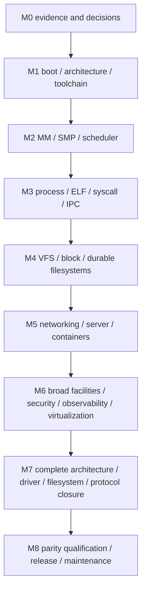

# Dependency-ordered roadmap: M0–M8

## Status and interpretation

This is the complete dependency-ordered porting program, now with a real bounded x86_64 bootstrap, an immutable integration/package checkpoint and subsequent foundation work in [implementation](implementation.md). **M1 is in progress, not complete**; M2–M8 remain milestone obligations. The unchanged five-column [workstream ledger](../planning/workstreams.tsv) marks only the canonical [routed implementation owners](implementation.md#routed-implementation-status) `in_progress`; all other rows remain `not_started`. This means real work has begun, not that any prefix is fully translated or Linux-compatible. M0 remains conditional on independent provenance/design review, reference configurations and access/recovery obligations. Local source-signature evidence now exists; no dates, staffing sufficiency, M1 completion, Linux parity, physical pass or performance pass are claimed.

The standing project rule is to continue implementation until every required facility is ported and evidence-qualified; it does **not** authorize representing the historical planning delivery or the current bootstrap as the finished kernel. [Definition of done](definition-of-done.md) supplies exhaustive per-unit/subsystem/full-kernel closure; this roadmap specifies dependency gates and milestone exit evidence. Accepted user constraints, recorded engineering choices and unresolved obligations are distinct in [decisions](decisions.md). Initial M1 sequencing and integration Clippy are engineering/verification choices, not newly invented detailed user approvals.

Accepted architecture/policy choices are a **modular monolithic Rust kernel**, unavoidable function-local **`asm!` and `naked_asm!` with proofs** (no `global_asm!` or standalone assembly), and a **fixed 6.18.57 feature/behavior inventory with explicitly reviewed security deltas**. Later feature-baseline changes require a separate decision. Per-operation assembly proofs, detailed security-delta approval workflow, maintenance cadence/resources, staffing and statistical levels remain review/decision work, not silently accepted defaults. Every baseline module's functionality needs a Rust replacement without legacy C execution; arbitrary third-party/proprietary out-of-tree functionality needs separate enumeration and approval.

Every milestone uses the same evidence tuple: pinned implementation/reference source; feature/configuration and ABI scope; compiler/linker/rootfs/firmware identities; case definitions/seeds; raw logs and individual outcomes; security/unsafe review; physical platform identity without unnecessary personal serial data; performance samples/noise/confidence; failure/recovery results; owner and unresolved blockers. A skip, unavailable device, benchmark ambiguity, placeholder, crash without diagnosis or silent test exclusion is not a pass. Exit applies to the explicitly enumerated milestone slice, never to the whole baseline unless M8 says so.

## Dependency map and concurrency

This is an integration dependency spine, not a ban on early parallel work. Storage format/parser research, driver inventory, network state-machine tests, architecture backend investigation, security hooks and packaging design begin before their integration milestones, once their shared contracts exist. Physical-hardware preparation starts at M0 and candidate physical execution starts at M1. Security, performance, observability, licensing and tests are continuous; M6 is broad facility closure, not the first security work. M7 is breadth closure, not the first non-x86 design research. Server priority never deletes desktop, audio/graphics, embedded/RT, legacy or obscure support.

The [subsystem index](README.md) and [workstream inventory](../planning/workstreams.tsv) determine owners. Shared allocator/locking/RCU/usercopy/DMA/device contracts are prerequisites for leaf implementation, and cross-subsystem API changes migrate all callers in one cutover.

## M0 — Evidence, executable planning tools and acceptance contracts

**Prerequisites:** approved user choices; upstream source/metadata access; a host Rust toolchain; explicit distinction between source inventory and implementation.

**Current evidence:** the original GitHub-only inventory history is preserved. Subsequent independent local kernel.org/GitHub fetches agree on the pinned tag/commit/tree, and isolated GPG verification reports a good signature under kernel.org HTTPS/WKD-pinned fingerprint `647F28654894E3BD457199BE38DBBDC86092693E`. GPG remains `TRUST_UNDEFINED`/`[unknown]`; no Web-of-Trust or ultimate trust is claimed. [Implementation source records](implementation.md#pinned-source-and-specification-map) and Q02 distinguish this authentication from outstanding independent review, per-file provenance and release acceptance.

**Ordered tasks**

1. Resolve `v6.18.57` tag → commit → complete tree, detect recursive API truncation, preserve retrieval and signature caveats, and independently verify upstream signing metadata before accepting source provenance. Preserve per-file licenses/notices and UAPI exceptions.
2. Assign the complete pinned tree to source-prefix workstreams, including metadata/build/docs/tests and every baseline architecture/driver/filesystem/network family. Enumerate per-file/facility/ABI/device closure units beyond directory coverage.
3. Implement the accepted modular monolithic direction and assembly permission boundaries in shared ownership/locking/context/runtime/module/configuration contracts; resolve remaining M1 blockers rather than relying on host defaults. Establish the reviewed security-delta ledger/process for the fixed 6.18.57 inventory; later feature-baseline changes require a separate decision.
4. Specify pinned reference configurations, Arch/CachyOS userspace/rootfs, initial balanced-server cases and later full matrix, compiler/security/firmware matching, and per-metric performance qualification method.
5. Record the only available physical machine, user-controlled install/boot/recovery workflow, console feasibility and safe storage/network boundaries. Enumerate missing vendors, NUMA/IOMMU/device/architecture access as blockers; do not assume purchases or remote lab access.
6. Deliver and actually exercise the Rust audit and bounded smoke runner, with positive and isolated negative cases, per-case outcomes and documented limits. Reference-host execution validates tooling only. Integrate sixteen local skills, complete linked plans, exhaustive DoD and the future package design without fake kernel artifacts.

**Correctness/exit evidence:** immutable baseline identities and complete inventory; audit output plus malformed-input diagnostics; runnable smoke report; all seven original and subsequent approved decisions preserved; M1 blocking decisions answered or explicitly blocking; owner/reviewer assignments and evidence templates. The local signature observation above does not by itself close provenance review or lab recovery. The original planning delivery and current bootstrap may exist while M0 remains conditional.

**Performance gate:** a real reference measurement plan and available-host baseline capture strategy, fair configuration/security equivalence rules, representative per-cell metrics and statistical decision policy. No kernel performance qualification is claimed from the bootstrap's bounded QEMU execution times. Approved balanced-server emphasis does not resolve the exact workload versions/parameters or omit other profiles.

**Physical gate:** user approves a safe manual runbook, known-good boot/recovery and nondestructive reference smoke path on the workstation. The supplied [bare-metal suite](bare-metal-suite.md) does not install/boot/reboot or prove hardware provenance. Required unavailable hardware is explicitly blocked, not replaced with QEMU.

**Owners:** integration, provenance/licensing, verification/performance/lab, toolchain and packaging. See [coverage](coverage.md), [research](research.md), [project audit](project-audit.md), [packaging](packaging.md).

## M1 — Rust-only toolchain, boot and architecture primitives

**Prerequisites:** M0 source/assembly/boot/runtime decisions needed for entry work; qualified target compiler/linker plan; reviewed workstation recovery route and user consent for any later candidate boot.

**Current bounded progress:** the native Limine base5/UEFI64 q35/OVMF bootstrap has checked handoff/ACPI data, real frame ownership/exhaustion/recovery, owned four-level CR3/W^X/guards and actual exception/PIC/PIT consumers. Historical cell9 and later maintained cells remain distinct. [Current evidence](implementation.md) includes006 saved-IF/real IRQ9/9, retained007 fatal-call alignment9/10 failure and corrected00810/10 with all15 returning-PF GPRs; director reviewed the actual008 default surface. Non-error entries use the exact compiler ABI; confirmed broken error-code boundaries use the necessary local repair. Physical001/002 are withdrawn; a reviewed corrected replacement is required. Host1.88 and exact runtime nightly1.101 remain separate. Private memory/SMP/image work is not a merged pass, full M1, userspace/storage implementation, physical qualification or pinned-Linux performance.

**Ordered tasks**

1. Establish reproducible Rust `no_std` image construction, entry layout/linker contract, compiler runtime symbol closure, panic/crash path and disassembly checks; demonstrate no hidden C runtime or standalone assembly dependency.
2. Implement minimal reviewed x86_64 entry/return and CPU feature discovery, boot information validation, reserved memory map, bounded boot allocator, stacks, page-table transition and permissions.
3. Bring up serial/diagnostic output before risky features; exceptions, descriptor/interrupt tables, interrupt controller, monotonic timer and debugger/context capture; avoid unbounded logging from NMI/IRQ.
4. Define platform/firmware handoff boundaries and implement the selected initial path with validation. Track remaining Linux boot protocols and firmware paths, including legacy support, for M7 closure rather than pretending a custom loader establishes Linux boot compatibility.
5. Prepare a separately identified genuine diagnostic image for an isolated storage-free M1 trial on user-owned recoverable media, with independent known-good recovery and no root-disk use. Exercise QEMU first; a subsequent physical boot remains user-operated and requires the image/platform/console/recovery review in [packaging](packaging.md). This diagnostic path can precede storage/rootfs/initramfs/userspace and is not a Linux-replacement package. That later package requires all real root-controller, durable filesystem, initramfs/init/userspace and advertised boot-manager prerequisites; no fake filesystem, empty package or waived dependency substitutes.
6. Add entry/exception/trap/boot-data failure tests, timeout/watchdog/recovery procedures and image/source/config metadata. Start non-x86 compiler/backend gap analysis without claiming target-triple support is sufficient.

**Correctness/exit evidence:** actual reproducible image and symbol audit; captured QEMU and physical serial/console boot/trap logs; correct memory reservations, CPU capability rejection, timer/interrupt handling and controlled panic/recovery; reviewed unsafe/assembly contracts. A banner alone is insufficient. No userspace/container claim.

**Performance gate:** compare boot-to-defined-checkpoint time, image/static memory footprint, clock calibration/interrupt overhead and idle behavior against corresponding reference measurements with instrumentation identified. Record unsupported comparisons as unqualified; no whole-kernel speed claim. Avoid needless boot allocations/copies without compromising diagnostics.

**Physical gate:** user boots candidate separately, demonstrates return to known-good kernel, captures real CPU/firmware/memory/interrupt behavior and clock sanity. Console/recovery unavailable is an M1 physical blocker. Missing additional-vendor hardware blocks that platform's evidence, not its inclusion in scope.

**Owners:** [architectures](subsystems/architectures.md), [core](subsystems/core.md), [memory](subsystems/memory.md), [firmware](subsystems/firmware.md), toolchain/unsafe/lab.

## M2 — Memory, SMP, scheduling and shared mechanisms

**Prerequisites:** M1 trusted entry, CPU/IRQ/clock/page-table primitives, usable debug evidence and known memory reservations.

**Ordered tasks**

1. Implement owned physical-page allocation, mapping objects and page-table management; permission checks, TLB shootdowns, bootstrap-to-mature allocator handoff, object/slab allocation and context-aware failure/accounting APIs.
2. Add CPU discovery/startup, per-CPU areas and migration guards, atomic/barrier primitives, raw/ordinary locks and lock-order diagnostics. Model representative ordering and refcount races before high-concurrency users.
3. Implement task contexts, run queues, scheduling, wakeup/wait/completion state machines, timers, deferred work and shutdown/hotplug foundations; preserve ownership across cancellation and CPU teardown.
4. Develop RCU/grace-period lifetime rules, deferred freeing, reclaim/no-IO/no-FS recursion, OOM forward progress, resource accounting and NUMA foundations. Broader policies remain tracked until their full gates pass.
5. Add guarded kernel stacks, fault injection, allocation exhaustion, SMP stress, race/model tests and debug lock/lifetime instrumentation; design RT/PI distinctions rather than entrenching incompatible universal spinlocks.

**Correctness/exit evidence:** allocator/mapping invariants under fragmentation/OOM; SMP startup, cross-CPU visibility and shootdown tests; no stale references after quiescence; lost-wakeup/cancellation/starvation/lock-order cases; stress/recovery with instrumentation. Single-core success cannot satisfy SMP.

**Performance gate:** allocator latency/tails and memory overhead; context-switch/wakeup/timer/interrupt cost; contention/scaling and NUMA-local/remote behavior where available. Paired reference conditions and sampling are required. Remove demonstrated unnecessary global locks, allocations, cacheline contention and copies only with regression evidence.

**Physical gate:** physical SMP, timer/topology, cache/TLB and memory-pressure tests on the workstation; NUMA/multi-socket, ECC/error injection, second CPU vendor and unavailable topologies remain blocked pending actual access. Do not simulate NUMA and label it physical qualification.

**Owners:** [memory](subsystems/memory.md), [core](subsystems/core.md), [process](subsystems/process.md), architecture/concurrency/verification/performance.

## M3 — Process, ELF, syscalls and IPC

**Prerequisites:** M2 task scheduling, safe memory/usercopy/fault handling, time and synchronization foundations; minimal in-memory file/execution infrastructure may precede M4's durable VFS gate.

**Ordered tasks**

1. Implement validated ELF loading, initial user address spaces, user/kernel transitions, stacks/TLS/auxv, dynamic-loader prerequisites and architecture syscall dispatch. Keep data layouts/errno/restarts architecture-correct.
2. Implement process/thread create/exec/exit/wait, IDs, credentials, file descriptor ownership, signals/frame delivery/restart, process groups/session/terminal prerequisites and timers/resource limits.
3. Implement mmap/protection/shared memory/fault semantics, futex ordering/PI prerequisites and pipe/Unix/System V/POSIX IPC in dependency order, with partial progress and cancellation tests. Coordinate full socket integration with M5.
4. Boot minimal known binaries then the pinned Arch/CachyOS loader/libc/userland slice; missing syscall behavior is an explicit failing case, not an accepted `ENOSYS` wall.
5. Add syscall differential tests, malformed ELF/ABI inputs, usercopy fault boundaries, signal/restart races, descriptor leaks, permission cases and compat-layout cases. Host-only tests are insufficient.

**Correctness/exit evidence:** real userspace execution/exec/wait and IPC, differential register/errno/state results, expected failure behavior and clean process teardown under concurrent signals/OOM. Initial ABI slice enumerated; all other ABIs stay open through M7.

**Performance gate:** syscall/exception transition, fork/exec/startup, IPC/futex latency/tails, CPU and per-process memory overhead, concurrency scaling. The bounded smoke runner can supply functional outcomes, not benchmark proof.

**Physical gate:** run the same candidate userspace smoke on physical hardware with actual syscall/signal/timer/SMP behavior; preserve manual recovery and user-returned artifacts. SIMD/xstate, mitigations and feature-specific paths require hardware-specific tests, not a QEMU-only assumption.

**Owners:** [process](subsystems/process.md), [IPC](subsystems/ipc.md), memory/ABI/security.

## M4 — VFS, block and durable filesystems

**Prerequisites:** M2 DMA/resource/locking foundations and M3 processes/descriptors/usercopy; reviewed storage isolation and sacrificial media access before destructive tests.

**Ordered tasks**

1. Implement VFS objects/lifetimes, path lookup, permission checks, dentries/inodes/files, mount namespaces, pseudo filesystems and coherent mapping/page-cache/writeback interfaces.
2. Implement block queue/request lifetime, completion/cancellation, flush/FUA/discard ordering, partitions, device discovery and real storage bus/DMA/IOMMU paths. Virtio-first debugging does not replace native storage support.
3. Port an explicitly selected writable baseline filesystem with real metadata/data integrity and recovery, then expand families through M7; no toy on-disk format substitutes for a supported Linux filesystem.
4. Test pathname races, links/rename/unlink, mmap/write coherence, locking, fsync/sync semantics, mount/permission boundaries and userspace tooling compatibility.
5. Exercise injected IO errors, low space/inodes, corruption, interrupted writes and crash recovery on disposable images and separately authorized sacrificial devices; verify data from an independent reference/repair path.

**Correctness/exit evidence:** Linux-compatible VFS/error behavior and independently checked persistent contents; reproducible write ordering and recovery evidence; no leaked/in-flight IO on detach; safe failure paths under OOM and IO errors. A successful write/read before power loss is not durability proof.

**Performance gate:** per-pattern IO throughput/latency/tails, CPU, cache/memory behavior, fsync latency, startup and storage power where measurable. Match filesystems, mount options, caching and durability guarantees; never win by omitting flushes or weakening security.

**Physical gate:** real storage/interrupt/DMA/IOMMU tests and recovery using isolated/sacrificial media. The current workstation's production disk is not authorized destructive test media. Missing safe disks or power/error-injection capability blocks those evidence cells. The supplied smoke suite performs sandboxed ordinary filesystem calls only and does not cover this destructive gate.

**Owners:** [storage](subsystems/storage.md), [filesystems](subsystems/filesystems.md), drivers/memory/firmware/security.

## M5 — Networking and first server/container workload

**Prerequisites:** M3 userland/process/IPC and M4 usable filesystems/block; memory/DMA/network-driver foundations; credential/isolation hooks introduced earlier, not deferred to M6.

**Ordered tasks**

1. Implement socket lifecycle, packet ownership, device queues, IP/ARP/neighbor/routing, TCP/UDP, loopback and initial physical NIC paths, with checksums/offloads/MTU/error behavior; broaden protocols through M7.
2. Port netlink/ioctl control, filtering/traffic control and namespace/device lifecycle required by the selected network and server workload; integrate timers and cancellation safely.
3. Complete server-critical proc/sysfs, credentials/capabilities, namespaces, cgroups/resource controllers, seccomp and filesystem/mount semantics needed for real container isolation. Do not call a privileged chroot or process launcher a container pass.
4. Run pinned Arch/CachyOS init/service and server/container userland stacks against the unchanged upstream Linux baseline and candidate. Record exact package/rootfs/workload versions and user configuration.
5. Exercise multi-process/container isolation, resource pressure, hostile packet/state input, network reconfiguration, restarts, concurrent storage/network load and end-to-end recovery. Keep desktop/RT/embedded and all other families assigned for later closure.

**Correctness/exit evidence:** actual selected server service and container application workloads, protocol differential results, isolation/permission tests, service stop/start/recovery and sustained mixed load. Microbenchmarks or one HTTP response alone do not satisfy this gate.

**Performance gate:** balanced-server throughput and p50/tails, CPU/request, memory/container, cold/warm startup, IO/network contention and energy/power. Qualify per workload and physical platform with matched mitigation/configuration; no aggregate pass masking a regression.

**Physical gate:** workstation native NIC/storage/IOMMU paths, real external network peer and isolated network safety. Loopback/virtio evidence does not qualify the physical NIC or line-rate behavior. Missing peer/multivendor NIC access is a named blocker.

**Owners:** [networking](subsystems/networking.md), [IPC](subsystems/ipc.md), process/security/storage/drivers/performance.

## M6 — Broad facilities, security, observability and virtualization

**Prerequisites:** M5 integrated workload; earlier security/observability foundations and shared contracts. Individual M6 tracks may start sooner when their concrete prerequisites pass.

**Ordered tasks**

1. Complete security-policy hooks/LSMs, audit, key/crypto/integrity facilities, mitigations, security module configuration, privilege-boundary tests and resource controls beyond the first workload.
2. Port tracing/perf/debug/crash instrumentation, coverage/fuzz feedback and required proc/sysfs/debug interfaces without treating unstable internal symbols as a frozen module ABI.
3. Implement eBPF verifier/interpreter/JIT and other extension mechanisms with separate security proof and architecture closure; implement Rust module relocation/loading/unload/signing/lifetime policies, never legacy C module loading.
4. Implement host/guest virtualization and KVM-facing device/ABI semantics on available architecture hardware, isolation and state migration/teardown where baseline requires them.
5. Integrate power/suspend/resume, CPU/device/memory hotplug, recovery/error reporting and RT/PI facilities with the relevant architecture/driver/core owners. Inventory remaining broad facilities rather than hiding them under generic miscellaneous labels.
6. Run adversarial fuzz/stress, policy conflicts, extension unload races, virtual-machine escape boundaries, crash capture and post-failure recovery under instrumentation and production configurations.

**Correctness/exit evidence:** feature-by-feature API/policy outputs, independent unsafe/security review, exploit regressions, verifier rejection and JIT equivalence cases, virtualization tests and crash recovery artifacts. Instrumentation must itself be validated, not merely enabled by a flag.

**Performance gate:** equal-policy security cost, perf/tracing overhead, extension throughput/tails, VM throughput/latency and consolidation, suspend/resume/startup and idle/power behavior. Security-disabled runs cannot qualify security-enabled requirements.

**Physical gate:** actual virtualization extensions, IOMMU/isolation, mitigation state and firmware/power/hotplug behavior on supported workstation features; unavailable TPM/security devices, second vendors and risky power/error injection remain blockers. No automated firmware changes or user-host reboot tests.

**Owners:** [security](subsystems/security.md), [observability](subsystems/observability.md), [virtualization](subsystems/virtualization.md), [extensions](subsystems/extensions.md), firmware/core.

## M7 — Full architecture, device, filesystem and protocol closure

**Prerequisites:** stable shared contracts from M1–M6 and per-family dependencies; complete closure inventory with no unowned baseline units. Access/toolchain work must already have started, not wait for M7.

**Ordered tasks**

1. Close every baseline architecture and ABI: compiler/backend and inline-assembly support, boot, MMU/cache/TLB/ordering, atomics, IRQ/time/SMP/NUMA, compat/time/endian layouts, mitigation and firmware behavior. Missing upstream Rust support requires Rust/compiler/backend work, never a C/assembly escape hatch.
2. Close every bus/device/driver family and documented platform variant: native storage/network, graphics/display/GPU, audio/input/media, USB/PCI and other buses, accelerators, embedded/industrial/legacy/staging facilities, power/thermal and unusual devices. Port legacy C-module functionality to Rust replacements.
3. Close all remaining disk/network/pseudo filesystems, storage formats, protocols/address families, filtering/control combinations and obsolete-but-present interfaces. Initial simpler implementations must now meet full observable behavior and performance.
4. Close real-time/embedded and desktop/application workloads, architecture-specific facilities, uncommon configurations and interactions. Finish source-derived metadata/build/configuration/docs/tests disposition alongside executable implementation.
5. For every inventory unit, attach actual implementation mapping, configuration/ABI/device matrix, provenance, security review, differential/adversarial/stress/recovery cases and performance results. Review residual coverage independently; directory counts are not the measure.

**Correctness/exit evidence:** all baseline units dispositioned with non-placeholder implementations and execution evidence; per-family tests and cross-subsystem interactions; no unsupported architecture/device silently relabeled out of scope. Removed upstream interfaces are distinguished from obsolete interfaces still present in the pinned source. An untestable physical device remains a qualification blocker, not a presumed pass.

**Performance gate:** extend fair per-cell comparisons to all workload classes, device/family variants, RT latency/jitter, desktop responsiveness, embedded footprint/power and all architectures. No server-weighted score can erase regressions elsewhere.

**Physical gate:** genuine multiple CPU/platform vendors, NUMA, IOMMU/DMA, native storage/NICs, graphics/audio/input, power/hotplug/error cases and remaining architecture boards/devices. Only one workstation is currently available, so most breadth evidence is explicitly blocked on lab access. Emulators accelerate debugging but cannot close these cells.

**Owners:** all subsystem/family maintainers, architecture/backend/driver/lab owners, independent coverage/security reviewers.

## M8 — Parity qualification, user-operated release and continuing maintenance

**Prerequisites:** M7 complete scoped closure, no unresolved release-blocking correctness/security/access/performance decisions, reproducible build/package candidates, trusted provenance and complete evidence manifests.

**Ordered tasks**

1. Freeze the release source/configuration/rootfs/workload/hardware matrix and reproduce candidates independently. Resolve baseline security drift explicitly; record source/security delta and rerun affected reference comparisons rather than silently changing the baseline.
2. Execute full differential, regression, negative, fuzz, stress, concurrency, durability, crash/recovery and real-application suites on debug and production profiles. Reproduce failures and retain raw evidence; no skip-based pass.
3. Qualify every required workload/hardware/metric cell as at least Linux under the accepted statistical policy. Regressions or uncertain results block release; optimize safely and rerun affected correctness and comparison suites.
4. Build the real separately named Arch-like package with Rust-owned packaging logic, provenance, debug symbols and external-tool records. Validate manual Limine/systemd-boot selection, preserving the working kernel, install/removal/upgrade and recovery behavior. Never publish a fake placeholder package or automatically change the user's host.
5. Complete licensing/notices/source availability, firmware trust records, independent unsafe/security review, release notes and honest support matrix. Issue the strongest claim justified by complete evidence, not universal hardware support inferred from a few machines.
6. Establish maintained vulnerability intake/triage, upstream stable-change monitoring, dependency/toolchain/security updates, responsible disclosure, release regression suites and repeated hardware/performance qualification. Full scope remains an ongoing obligation after initial release.

**Correctness/exit evidence:** every M0–M7 acceptance item and [full-kernel DoD](definition-of-done.md), immutable full-matrix results, reproducible source/binary/package correspondence, security/provenance approvals and real install/boot/recovery reports. All baseline functionality ported is a separate assertion from all required hardware qualified, and both are required for an unrestricted full-parity claim.

**Performance gate:** no unqualified required cell, no hidden throughput/latency/memory/CPU/startup/power regression and no mitigation downgrade. Confidence/noise insufficient to establish at-least-baseline behavior is unresolved, not success. New fixes/configuration/toolchain changes invalidate affected qualification until rerun.

**Physical gate:** signed-off user-operated workstation package boot/recovery plus every required physical platform/device class; missing access still blocks universal release claims. Physical suite labels and VM flags alone are not evidence of actual hardware. Maintain a repeatable non-destructive smoke path and separately authorized destructive lab suites.

**Owners:** release/integration, all subsystem maintainers, ABI/security/provenance, performance/verification/lab and package owners. See [maintenance](maintenance.md), [packaging](packaging.md), [verification](verification.md), [performance](performance.md), [bare metal](bare-metal.md).

## Primary rationale and reference links

- [Pinned Linux x86 boot protocol](https://raw.githubusercontent.com/gregkh/linux/v6.18.57/Documentation/arch/x86/boot.rst): boot protocol variants and memory handoff are real compatibility work, not merely a linker entry address.
- [Pinned lock categories and RT differences](https://raw.githubusercontent.com/gregkh/linux/v6.18.57/Documentation/locking/locktypes.rst) and [allocation contexts](https://raw.githubusercontent.com/gregkh/linux/v6.18.57/Documentation/core-api/memory-allocation.rst): shared mechanism gates precede safe subsystem concurrency.
- [Pinned ABI guidance](https://raw.githubusercontent.com/gregkh/linux/v6.18.57/Documentation/ABI/README) and [testing overview](https://raw.githubusercontent.com/gregkh/linux/v6.18.57/Documentation/dev-tools/testing-overview.rst): behavior/system tests and internal tests have different scope.
- [rustc platform support](https://doc.rust-lang.org/rustc/platform-support.html) and [Rust inline assembly](https://doc.rust-lang.org/reference/inline-assembly.html): architecture/backend existence and actual kernel execution need separate evidence.

Milestone decomposition, staffing roles and proposed implementation sequencing are project design recommendations, not claims made by these upstream sources.
